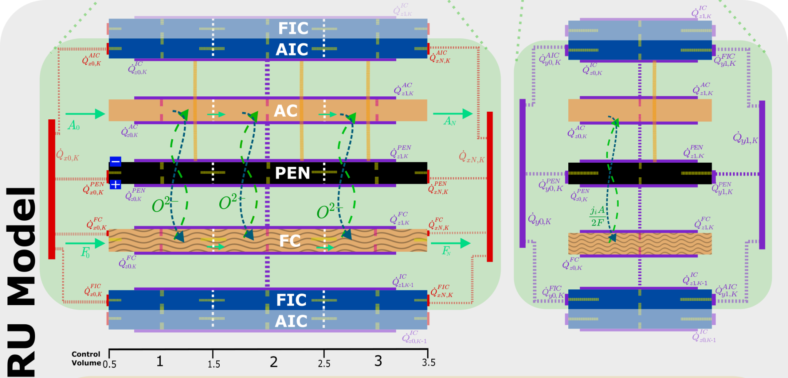
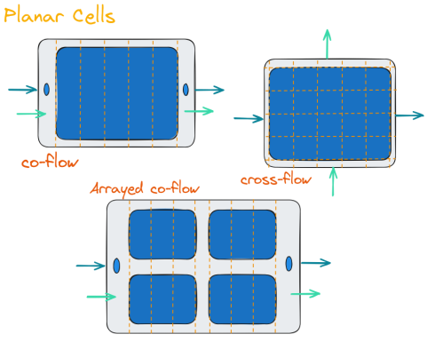
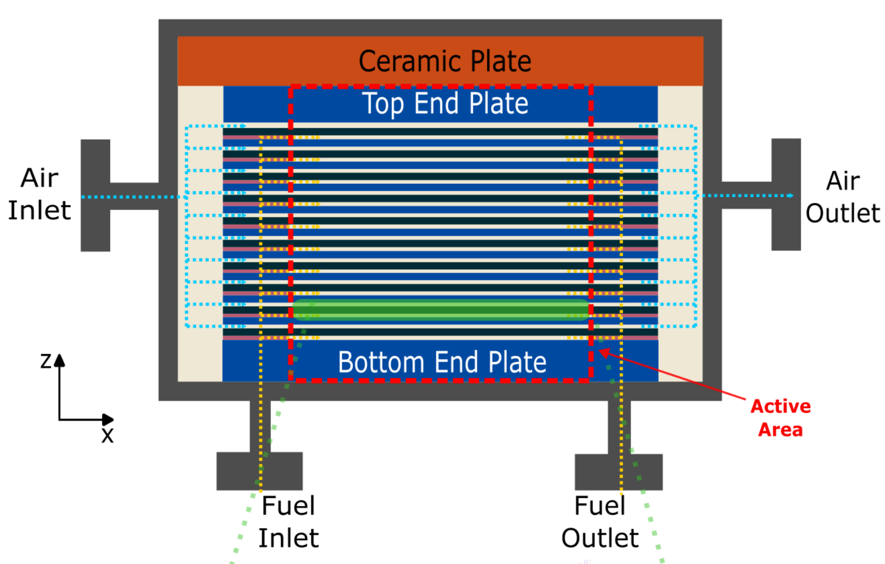

# Framework Structure & Modeling Levels

openTEMPEST is built as a **modular, object-oriented framework** designed to simulate electrochemical energy systems across multiple scales. Depending on the specific research question, it enables proven simplification approaches at all modeling levels. 

  

In essence, the modeling levels are defined as follows:
1. Electrochemical objects
2. Cell models
3. Stack models
4. Multi-stack / module models
5. System models

In the following, the framework is explained taking the solid oxide cell technology as an example.

**Figure could be extended to cover all five modeling levels**

## 1. Electrochemical Objects
 
*Folder: OpenTEMPEST/SOC/Electrochem*

Reusable components that describe the electrochemical characteristics independent of geometry and usually obtained from cell experiments. Depending on cell technology and available measurement data, detailed or lumped approaches are available:

- **Lumped Electrochemistry (ASR)**: simplifies the U,i-characteristics as a temperature dependent area-specific resistance (ASR)  
`OpenTEMPEST.SOC.Electrochem.Components.ASR_ElectrochemBase`

- **Detailed Electrochemistry**: breakdown of voltage losses into:
  - Ohmic overpotential (by means of an ohmic ASR (*T*) expression) 
  - Activation overpotentials (by means of Butler Volmer equations)
  - Diffusion overpotentials (by means of Dusty Gas Model)
  
  Models extending from `OpenTEMPEST.SOC.Electrochem.Components.BV_ElectrochemBase` consider this.

By taking advantage of the OOP capabilities, we are able to abstract away different mathematical formulations for the different resistances in the electrodes. A user made electrochemistry object could be made to have different functionality and be utilised in our, or their own cell and stack models, as long as they extend from `ElectrochemBase`.

## 2. Cell Models (Repeating Units (RU))

  

 *Folder: OpenTEMPEST/SOC/Cell*

Cell models are composed of the following sub-components, which form a repeating unit for stack modeling:
- **Electrochemcially active solid** (positive-electrolyte-negative, PEN), defined by its geometry and thermophysical properties - mainly solves the energy balance in the cell solid, incorporating the electrochemical objects from Modeling Level 1 and thermally interfacing with the channels and interconnects via convection and radiation, respectively.
- **Air and Fuel gas channels** defined by its geometry and thermophysical properties - solves the energy, mass and momentum balance equations. Interacts with the PEN and Interconnects via convection, considers side chemical reactions that may occur on the catalytic surfaces in the channels. Discretised using FVM, replaceable discretisation interpolation schemes found in `OpenTEMPEST.Flow.FluxInterpolators` are used to resolve the balance equations.
- **Interconnector**, virtually distributed into a half air electrode interconnect (AIC) and fuel electrode interconnect (FIC) for each repeating unit. Interacts with gas channels via convection and adjacent half interconnect via conduction and PEN via radiation. It extends from the `OpenTEMPEST.Heat.SolidXD` models (i.e. Solid 1D or Solid2D etc.), just like the PEN model, which holds the energy balance equations.

As of now, the following planar cell models are available:

| Model | Discretization               | Use Case                                                                                                                                                                                                                             |
| -------| ------------------------------| --------------------------------------------------------------------------------------------------------------------------------------------------------------------------------------------------------------------------------------|
| 1D    | Along-the-flow (co-flow)     | Precise quantification of property distribution (temperature, current density etc.) as well as spatial and temporal gradients, observation of superimposed temperature-dependent phenomena (internal reforming/cracking/methanation) |
| 2D    | Along-the-flows (cross-flow) | Precise quantification of property distribution as well as spatial and temporal gradients, especially relevant when flow directions are not parallel or lateral plane phenomena becomes significant                                  |

These models can be written in many different ways. Simplification approaches can also be employed at the cell level, for example the model `OpenTEMPEST.SOC.Cell.CrossFlow.CellCFSimp` reduces the flow channels in the crossflow cell from 2D to 1D while keeping the solid surfaces as 2D. Ths has the benefit of significantly reducing the number of equations needed to solve the balance equations, as the number of computationally heavy fluid states is reduced, while keeping thermal information in the PEN to a high precision - this does come at the cost of some model accuracy. `OpenTEMPEST.SOC.Cell.CrossFlow.CellGeneral` gives a clean interfaces to have functionality of both models based on the parameters set.

These component and cell models can be used to make different cell types, such as the arayed (segmented) cells, which will be included very soon to the OpenTEMPEST library, as well as different flow configurations.Even cells with different flow geometries such as tubular cells can be modelled in this way.

  

## 3. Stack Models

  

Stack models combine a set of cell models, along with end plates, manifolds, flow distribution and specifications of heat transfer to surrounding.

| Model | Discretization | Use case |
| -------| ----------------| ----------|
| A1    | B1             | C1       |
| A2    | B2             | C2       |
| A3    | B3             | C3       |

<!---
STILL MISSING: 
- TABLE OF AVAILABLE STACK MODELS ( 0D, 1D, 2D (CF))
- REFERENCES TO MODELICA FILES
- SIMPLIFICATION APPROACHES: MARIUS' APPROACH
--->

## 4. Multi-Stack (Module) Models

Module models enable the depiction of commercial-like assemblies of multiple stacks inside a shared thermal environment. 

We are still working on providing an example of such a model in OpenTEMPEST - please bare with us :)

<!--- 
STILL MISSING: 
- TABLE OF AVAILABLE MODELS (OR EXAMPLES)
- REFERENCES TO MODELICA FILES

--->

## 5. System Models

**Balance of Plant (BoP)** component models enable the full depiction of real test rigs or large-scale commerical systems. BoP models are implemented to depict their off-design behavior in order to correctly reproduce the thermal system behavior in part-load conditions.

**Available BoP components:**
- Gas-Gas Heat exchangers 
- Electrical Heaters
- Afterburners
- Evaporators
- Compressors and blowers
- Pre-reformers
- Downstream chemical reactors (electrolysis mode)

<!--- 
STILL MISSING: 
- REFERENCES TO MODELICA FILES
--->

[Return to main page](../README.md)