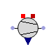
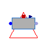
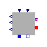

## [OpenTEMPEST](OpenTEMPEST.md#opentempest).BOP

### Package Content

| Name | Description |
|----|----|
|  [FanSimple](OpenTEMPEST_BOP.md#opentempestbopfansimple) |   |
|  [Compressor](OpenTEMPEST_BOP.md#opentempestbopcompressor) |   |
|  [Evaporator](OpenTEMPEST_BOP.md#opentempestbopevaporator) |   |
|  [Vaporizer](OpenTEMPEST_BOP.md#opentempestbopvaporizer) | Evaporator model. Input is mass flow in water. Output is water vapor as gas mix. All extensive variables are depending on the mass flow. |
|  [PowerElectronics](OpenTEMPEST_BOP.md#opentempestboppowerelectronics) | Model of a power electronics unit including AC/DC conversion |
|  [PumpSimple](OpenTEMPEST_BOP.md#opentempestboppumpsimple) | simple pump model for incompressible fluids |
|  [GasConditioning](OpenTEMPEST_BOP_GasConditioning.md#opentempestbopgasconditioning) |   |
|  [Reactors](OpenTEMPEST_BOP_Reactors.md#opentempestbopreactors) |   |

##  [OpenTEMPEST.BOP](OpenTEMPEST_BOP.md#opentempestbop).FanSimple

### Information

Extends from ThermoPower.Icons.Gas.Fan.

### Parameters

| Name | Description |
|----|----|
| replaceable package Medium | Medium model |
| eta | Polytropic efficency |
| allowFlowReversal | = true to allow flow reversal, false restricts to design direction |
| Initialisation |  |
| hStart | Fluid Specific Enthalpy Start Value \[J/kg\] |

### Connectors

| Name                       | Description  |
|----------------------------|--------------|
| replaceable package Medium | Medium model |
| fl_inlet                   |              |
| fl_outlet                  |              |
| in_mf                      |              |
| powerConnection            |              |

##  [OpenTEMPEST.BOP](OpenTEMPEST_BOP.md#opentempestbop).Compressor

### Parameters

| Name                       | Description           |
|----------------------------|-----------------------|
| eta                        | Polytropic efficiency |
| etaM                       | Mechanical efficiency |
| etaE                       | Electrical efficiency |
| replaceable package Medium | Medium model          |

### Connectors

| Name                       | Description    |
|----------------------------|----------------|
| replaceable package Medium | Medium model   |
| inlet                      |                |
| outlet                     |                |
| powerConnection            |                |
| heatLosses                 |                |
| Pi                         | Pressure ratio |

##  [OpenTEMPEST.BOP](OpenTEMPEST_BOP.md#opentempestbop).Evaporator

### Information

Extends from Modelica.Icons.UnderConstruction (Icon for classes that are still under construction).

### Parameters

| Name | Description |
|----|----|
| replaceable package gasPhaseMedium |   |
| Vd | Drum internal volume \[m3\] |
| Mm | Drum metal mass \[kg\] |
| cm | Specific heat capacity of the drum's metal \[J/(kg.K)\] |
| Kv | Nominal hydraulic conductance of the control valve \[(kg/s)/Pa\] |
| Initialisation |  |
| pStart | Pressure start value \[Pa\] |
| VlStart | Start value of drum water volume \[m3\] |

### Connectors

| Name                               | Description |
|------------------------------------|-------------|
| replaceable package gasPhaseMedium |             |
| inlet                              |             |
| outlet                             |             |
| hT                                 |             |
| controlValvePosition               |             |

##  [OpenTEMPEST.BOP](OpenTEMPEST_BOP.md#opentempestbop).Vaporizer

Evaporator model. Input is mass flow in water. Output is water vapor as gas mix. All extensive variables are depending on the mass flow.

### Parameters

| Name                             | Description           |
|----------------------------------|-----------------------|
| thermalInput                     |                       |
| pStart                           | \[Pa\]                |
| replaceable package MediumInput  |                       |
| replaceable package MediumOutput |                       |
| mfNom                            | Massflowrate \[kg/s\] |

### Connectors

| Name                             | Description |
|----------------------------------|-------------|
| replaceable package MediumInput  |             |
| replaceable package MediumOutput |             |
| waterInlet                       |             |
| gasOutlet1                       |             |
| port                             |             |
| dHTVolumes                       |             |

##  [OpenTEMPEST.BOP](OpenTEMPEST_BOP.md#opentempestbop).PowerElectronics

Model of a power electronics unit including AC/DC conversion

### Parameters

| Name | Description |
|----|----|
| nChannels | Number of parallel electrical channels |
| currentFactor | Liniar factor, which is multiplied with the input current |
| aLoss | Parameter for AC/DC loss and aux power calculation of power; form: a \* x^2 + b\*x + c |
| bLoss |   |
| cLoss |   |
| desginPower | Desgin power for AC/DC loss and aux power calculation per channel |
| useVoltageInput | Use a voltage set value instead a current set value |
| nCells | Number of total cells attached (only for UAvg calc) |

### Connectors

| Name                      | Description                |
|---------------------------|----------------------------|
| currentInput\[nChannels\] | The set current \[A\]      |
| pinN\[nChannels\]         | Negative pins              |
| pinP\[nChannels\]         | Positives pins             |
| sensors                   | Sensor bus                 |
| gridConnectionAC          | AC grid connection         |
| voltageInput\[nChannels\] | The set voltage            |
| PDC                       | DC power \[W\]             |
| PAC                       | AC power \[W\]             |
| UAvg                      | Average cell voltage \[V\] |

##  [OpenTEMPEST.BOP](OpenTEMPEST_BOP.md#opentempestbop).PumpSimple

simple pump model for incompressible fluids

### Information

Model for a simple pump, based on assumption:

1.  incompressible fluid (d
    rho\<\code\>/d
    p = 0)
2.  no internal Volume in pump
3.  adiabatic pump

- P = mf (h2 - h1)\
  eta_isen= dh_isen/dh_poly, with h_isen = vdp\
  P= mf \* dh_poly = mf \* dh_isen/eta_isen = mf \*vdp/eta_isen\
  --\> resource image with equations to be inserted

Extends from ThermoPower.Icons.Water.Pump.

### Parameters

| Name | Description |
|----|----|
| replaceable package Medium | Medium model |
| eta_isen | isentropic efficency |
| eta_el | electrical efficency |
| eta_mech | mechanical efficency |
| allowFlowReversal | = true to allow flow reversal, false restricts to design direction |
| Initialisation |  |
| hStart | Fluid Specific Enthalpy Start Value \[J/kg\] |

### Connectors

| Name                       | Description  |
|----------------------------|--------------|
| replaceable package Medium | Medium model |
| fl_inlet                   |              |
| fl_outlet                  |              |
| in_mf                      |              |
| powerConnection            |              |

[Automatically generated](http://www.3ds.com/) Sun Sep 20 19:09:47 2026.
