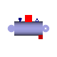

## [OpenTEMPEST.BOP](OpenTEMPEST_BOP.md#opentempestbop).GasConditioning

### Package Content

| Name | Description |
|----|----|
|  [ExpansionTank](OpenTEMPEST_BOP_GasConditioning.md#opentempestbopgasconditioningexpansiontank) | Header with metal walls for water/steam flows |
|  [CoolingCycle](OpenTEMPEST_BOP_GasConditioning.md#opentempestbopgasconditioningcoolingcycle) | Heat exchanger with integrated water cycle. |
|  [ElectricalHeater0D](OpenTEMPEST_BOP_GasConditioning.md#opentempestbopgasconditioningelectricalheater0d) |   |
|  [ElectricHeater0D](OpenTEMPEST_BOP_GasConditioning.md#opentempestbopgasconditioningelectricheater0d) |   |
|  [ElectricHeater1D](OpenTEMPEST_BOP_GasConditioning.md#opentempestbopgasconditioningelectricheater1d) |   |
|  [SimpleGasHeater](OpenTEMPEST_BOP_GasConditioning.md#opentempestbopgasconditioningsimplegasheater) |   |
|  [SimpleGasHeaterVol](OpenTEMPEST_BOP_GasConditioning.md#opentempestbopgasconditioningsimplegasheatervol) |   |
|  [BlackBoxHexGeneric](OpenTEMPEST_BOP_GasConditioning.md#opentempestbopgasconditioningblackboxhexgeneric) |   |
|  [Separator](OpenTEMPEST_BOP_GasConditioning.md#opentempestbopgasconditioningseparator) | Separator with metal walls for gas flows |
|  [HexEtaTypes](OpenTEMPEST_BOP_GasConditioning_HexEtaTypes.md#opentempestbopgasconditioninghexetatypes) |   |
|  [NTUfuns](OpenTEMPEST_BOP_GasConditioning_NTUfuns.md#opentempestbopgasconditioningntufuns) |   |

##  [OpenTEMPEST.BOP.GasConditioning](OpenTEMPEST_BOP_GasConditioning.md#opentempestbopgasconditioning).ExpansionTank

Header with metal walls for water/steam flows

### Information

This model describes a constant volume header with metal walls. The fluid can be water, steam, or a two-phase mixture.

It is possible to take into account the heat storage and transfer in the metal wall in two ways:

- Leave `InternalSurface` unconnected, and set the appropriate values for the total wall heat capacity `Cm`, surface `S` and heat transfer coefficient `gamma`. In this case, the metal wall temperature is considered as uniform, and the wall is thermally insulated from the outside.
- Set `Cm = 0`, and connect a suitable thermal model of the the wall to the `InternalSurface` connector instead. This can be useful in case a more detailed thermal model is needed, e.g. for thermal stress studies.

The model can represent an actual header when connected to the model of a bank of tubes (e.g., `Flow1D` with `Nt>1`).

Extends from ThermoPower.Icons.Water.Header.

### Parameters

| Name | Description |
|----|----|
| replaceable package Medium | Medium model |
| V | Inner volume \[m3\] |
| S | Internal surface \[m2\] |
| H | Elevation of outlet over inlet \[m\] |
| gamma | Heat Transfer Coefficient \[W/(m2.K)\] |
| Cm | Metal Heat Capacity \[J/K\] |
| allowFlowReversal | = true to allow flow reversal, false restricts to design direction |
| thermalPort | Internal surface of metal wall |
| Initialisation |  |
| FluidPhaseStart | Fluid phase (only for initialization!) |
| pstart | Pressure start value \[Pa\] |
| hstart | Specific enthalpy start value \[J/kg\] |
| Tmstart | Metal wall temperature start value \[K\] |
| initOpt | Initialisation option |
| noInitialPressure | Remove initial equation on pressure |
| noInitialEnthalpy | Remove initial equation on enthalpy |
| gasShareStart | Start share gas |

### Connectors

| Name                       | Description                    |
|----------------------------|--------------------------------|
| replaceable package Medium | Medium model                   |
| inlet                      |                                |
| outlet                     |                                |
| thermalPort                | Internal surface of metal wall |

##  [OpenTEMPEST.BOP.GasConditioning](OpenTEMPEST_BOP_GasConditioning.md#opentempestbopgasconditioning).CoolingCycle

Heat exchanger with integrated water cycle.

### Parameters

| Name | Description |
|----|----|
| replaceable package MediumHeating |   |
| replaceable package MediumCooling |   |
| VExpansionTank | Inner volume \[m3\] |
| UACooling | Termal conductence \[W/K\] |
| LHeat | Heat tube lenght \[m\] |
| DHeat | Heat tube diameter \[m\] |
| omegaHeat | Perimeter of heat transfer surface (single heat tube) \[m\] |
| wnomHeat | Heat Nominal mass flowrate (total) \[kg/s\] |
| wnomCooling | Cooling Nominal mass flowrate (total) \[kg/s\] |
| replaceable function flowCharacteristicPump | Head vs. q_flow characteristic at nominal speed and density |

### Connectors

| Name | Description |
|----|----|
| replaceable package MediumHeating |   |
| replaceable package MediumCooling |   |
| replaceable function flowCharacteristicPump | Head vs. q_flow characteristic at nominal speed and density |
| u_s |   |
| waterInlet |   |
| waterOutlet |   |
| gasInlet |   |
| gasOutlet |   |
| TR |   |

##  [OpenTEMPEST.BOP.GasConditioning](OpenTEMPEST_BOP_GasConditioning.md#opentempestbopgasconditioning).ElectricalHeater0D

### Parameters

| Name                       | Description                            |
|----------------------------|----------------------------------------|
| replaceable package Medium |                                        |
| l                          | length of flow channel \[m\]           |
| d                          | diameter of flow channel \[m\]         |
| nHeatingElements           |                                        |
| Pnom                       | Nominal active power consumption \[W\] |
| TStart                     | \[K\]                                  |
| pStart                     | \[Pa\]                                 |
| xStart\[Medium.nX\]        | \[1\]                                  |

### Connectors

| Name                       | Description |
|----------------------------|-------------|
| replaceable package Medium |             |
| inlet                      |             |
| outlet                     |             |
| powerConnection            |             |
| power                      |             |

##  [OpenTEMPEST.BOP.GasConditioning](OpenTEMPEST_BOP_GasConditioning.md#opentempestbopgasconditioning).ElectricHeater0D

### Information

Extends from ThermoPower.Icons.Gas.Tube.

### Parameters

| Name | Description |
|----|----|
| replaceable package Medium | Medium model |
| PMax | Maximal power \[W\] |
| PI_k | Gain of controller \[1\] |
| PI_Ti | Time constant of controller's Integrator block \[s\] |
| C | Heat capacity of element (= cp\*m) \[J/K\] |
| TStart | Temperature of element \[K\] |

### Connectors

| Name                       | Description  |
|----------------------------|--------------|
| replaceable package Medium | Medium model |
| in_TSet                    | \[K\]        |
| fl_inlet                   |              |
| powerConnection            |              |
| fl_outlet                  |              |
| out_TAct                   | \[K\]        |
| htAmb                      |              |

##  [OpenTEMPEST.BOP.GasConditioning](OpenTEMPEST_BOP_GasConditioning.md#opentempestbopgasconditioning).ElectricHeater1D

### Parameters

| Name | Description |
|----|----|
| replaceable package Medium |   |
| N |   |
| Ntubes | number of individual tubes |
| LUDS | Set LU discretisation |
| L | length of the heater tube \[m\] |
| Dhyd | hydraulic diameter of the heater tube \[m\] |
| A | cross sectional area of the heater \[m2\] |
| dpdx | nominal pressure drop |
| TStartIn | Inlet temperature to the heater starting value \[K\] |
| TStartOut | starting outlet temperature \[K\] |
| pStart | start pressure for initialization \[Pa\] |
| xStart\[Medium.nX\] | starting composition for initilization \[1\] |
| Efficiency | thermal efficiency of the heater |

### Connectors

| Name                       | Description |
|----------------------------|-------------|
| replaceable package Medium |             |
| flangeA                    |             |
| flangeB                    |             |
| PowerIn                    |             |
| port                       |             |
| heatloss                   |             |

##  [OpenTEMPEST.BOP.GasConditioning](OpenTEMPEST_BOP_GasConditioning.md#opentempestbopgasconditioning).SimpleGasHeater

### Information

Extends from [Flow.BaseClasses.simpleGasHeaterBase](OpenTEMPEST_Flow_BaseClasses.md#opentempestflowbaseclassessimplegasheaterbase).

### Parameters

| Name | Description |
|----|----|
| replaceable package medium |   |
| l | lenght of flow channel \[m\] |
| h | height of flow channel between two parallel plates \[m\] |
| w | width of flow channel between two parallel plates \[m\] |
| d | diameter of flow channel in a pipe \[m\] |
| TStart | \[K\] |
| pStart | \[Pa\] |
| xStart\[medium.nX\] | \[1\] |
| maximalFlow | maximal mass flow rate \[kg/s\] |
| allowFlowReversal | = true to allow flow reversal, false restricts to design direction |
| pipe | = true if flow through a pipe, false if between two parallel plates |
| nParallel | number of parallel flow ducts |
| useAlphaIn | Do not colculate heat transfer but use inlet coefficient |
| nHT | number of heat port in flow direction |

### Connectors

| Name      | Description |
|-----------|-------------|
| inlet     |             |
| outlet    |             |
| alphaIn   |             |
| ht\[nHT\] |             |

##  [OpenTEMPEST.BOP.GasConditioning](OpenTEMPEST_BOP_GasConditioning.md#opentempestbopgasconditioning).SimpleGasHeaterVol

### Information

Extends from [Flow.BaseClasses.simpleGasHeaterBase](OpenTEMPEST_Flow_BaseClasses.md#opentempestflowbaseclassessimplegasheaterbase).

### Parameters

| Name | Description |
|----|----|
| replaceable package medium |   |
| l | lenght of flow channel \[m\] |
| h | height of flow channel between two parallel plates \[m\] |
| w | width of flow channel between two parallel plates \[m\] |
| d | diameter of flow channel in a pipe \[m\] |
| TStart | \[K\] |
| pStart | \[Pa\] |
| xStart\[medium.nX\] | \[1\] |
| maximalFlow | maximal mass flow rate \[kg/s\] |
| allowFlowReversal | = true to allow flow reversal, false restricts to design direction |
| pipe | = true if flow through a pipe, false if between two parallel plates |
| nParallel | number of parallel flow ducts |
| useAlphaIn | Do not colculate heat transfer but use inlet coefficient |
| R | Hydraulic resistance \[Pa/(kg/s)\] |
| includePressureLoss |   |
| Initialisation |  |
| noInitialPressure | Remove initial equation on pressure |

### Connectors

| Name    | Description |
|---------|-------------|
| inlet   |             |
| outlet  |             |
| alphaIn |             |
| ht      |             |

##  [OpenTEMPEST.BOP.GasConditioning](OpenTEMPEST_BOP_GasConditioning.md#opentempestbopgasconditioning).BlackBoxHexGeneric

### Parameters

| Name                        | Description                          |
|-----------------------------|--------------------------------------|
| replaceable package MediumA |                                      |
| replaceable package MediumB |                                      |
| C                           | \[J/K\]                              |
| replaceable model etaType   |                                      |
| Tstart                      |                                      |
| xStartA\[MediumA.nX\]       | \[1\]                                |
| xStartB\[MediumB.nX\]       | \[1\]                                |
| y_start_w0                  | Initial value for mass flow medium A |
| y_start_p0                  | Initial value for pressure medium B  |

### Connectors

| Name                        | Description |
|-----------------------------|-------------|
| replaceable package MediumA |             |
| replaceable package MediumB |             |
| replaceable model etaType   |             |
| inletB                      |             |
| inletA                      |             |
| outletA                     |             |
| outletB                     |             |
| htAmbA                      |             |
| htAmbB                      |             |

##  [OpenTEMPEST.BOP.GasConditioning](OpenTEMPEST_BOP_GasConditioning.md#opentempestbopgasconditioning).Separator

Separator with metal walls for gas flows

### Information

This model describes a constant volume mixer with metal walls. The metal wall temperature and the heat transfer coefficient between the wall and the fluid are uniform. The wall is thermally insulated from the outside.

**Modelling options**

The actual gas used in the component is determined by the replaceable `Medium` package. In the case of multiple component, variable composition gases, the start composition is given by `Xstart`, whose default value is `Medium.reference_X`.

Extends from ThermoPower.Icons.Gas.Mixer.

### Parameters

| Name | Description |
|----|----|
| replaceable package Medium |   |
| V | Inner volume \[m3\] |
| S | Inner surface \[m2\] |
| gamma | Heat Transfer Coefficient \[W/(m2.K)\] |
| Cm | Metal heat capacity \[J/K\] |
| allowFlowReversal | = true to allow flow reversal, false restricts to design direction |
| seperationFactor\[Medium.nXi\] | Seperated fraction per species |
| thermalPort |   |
| Initialisation |  |
| pstart | Pressure start value \[Pa\] |
| Tstart | Temperature start value \[K\] |
| Xstart\[Medium.nX\] | Start gas composition \[kg/kg\] |
| Tmstart | Metal wall start temperature \[K\] |
| initOpt | Initialisation option |
| noInitialPressure | Remove initial equation on pressure |
| noInitialTemperature | Remove initial equation on temperature |

### Connectors

| Name                       | Description |
|----------------------------|-------------|
| replaceable package Medium |             |
| inlet                      |             |
| outletMain                 |             |
| outletSeperated            |             |
| thermalPort                |             |

[Automatically generated](http://www.3ds.com/) Sun Sep 20 19:09:47 2026.
