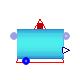
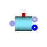

## [OpenTEMPEST.BOP.Reactors](OpenTEMPEST_BOP_Reactors.md#opentempestbopreactors).MeOH

### Package Content

| Name | Description |
|----|----|
|  [MeOHEnergyBalance](OpenTEMPEST_BOP_Reactors_MeOH.md#opentempestbopreactorsmeohmeohenergybalance) | Methanol reactor model, balancing component and heat streams, based on defined inflow and fixed conversion rate |
|  [MeOHReactorSystem](OpenTEMPEST_BOP_Reactors_MeOH.md#opentempestbopreactorsmeohmeohreactorsystem) | System representing a MeOH reactor process with separation, compression and heat transfer for heat balancing purposes |
|  [LiquidSeparator](OpenTEMPEST_BOP_Reactors_MeOH.md#opentempestbopreactorsmeohliquidseparator) | Model that allows for representing plant components that separate specific components of a mixture flow |

##  [OpenTEMPEST.BOP.Reactors.MeOH](OpenTEMPEST_BOP_Reactors_MeOH.md#opentempestbopreactorsmeoh).MeOHEnergyBalance

Methanol reactor model, balancing component and heat streams, based on defined inflow and fixed conversion rate

### Information

Extends from Modelica.Icons.UnderConstruction (Icon for classes that are still under construction).

### Parameters

| Name | Description |
|----|----|
| replaceable package Medium |   |
| conversion | ratio C/H\>=0.25; const conversion rate nMeOH/(nCO+nCO2)in |
| maxH2conversion | value between 0...1; maximum H2 conversion |
| TReactor | \[K\] temperature of Purge gas (unequal reactor temperature) \[K\] |
| TPurge | \[K\] temperature of Purge gas (unequal reactor temperature) \[K\] |
| TProduct | \[K\] temperature of condensated product flow \[K\] |
| pReactor | pressure gas Purge after flush/sparator (unequal reator pressure) \[Pa\] |
| fac | factor for accoutning for additional heat sinks |
| dhvMeOH | \[J/kg\] latent heat of evaporization Methanol at respective T,p \[J/kg\] |

### Connectors

| Name                       | Description |
|----------------------------|-------------|
| replaceable package Medium |             |
| infl                       |             |
| outflPurge                 |             |
| outMfProduct               |             |
| hT                         |             |

##  [OpenTEMPEST.BOP.Reactors.MeOH](OpenTEMPEST_BOP_Reactors_MeOH.md#opentempestbopreactorsmeoh).MeOHReactorSystem

System representing a MeOH reactor process with separation, compression and heat transfer for heat balancing purposes

### Information

Extends from Modelica.Icons.UnderConstruction (Icon for classes that are still under construction).

### Parameters

| Name | Description |
|----|----|
| MeOH Reactor |  |
| conversion | ratio C/H\>=0.25; const conversion rate nMeOH/(nCO+nCO2)in |
| TReactor | \[K\] temperature of Purge gas (unequal reactor temperature) \[K\] |
| TPurge | \[K\] temperature of Purge gas (unequal reactor temperature) \[K\] |
| TProduct | \[K\] temperature of condensated product flow \[K\] |
| pReactor | pressure gas Purge after flush/sparator (unequal reator pressure) \[Pa\] |
| dhvMeOH | \[J/kg\] |

### Connectors

| Name       | Description |
|------------|-------------|
| mfMeOH     |             |
| hT         |             |
| infl       |             |
| outflWater |             |
| outflPurge |             |

##  [OpenTEMPEST.BOP.Reactors.MeOH](OpenTEMPEST_BOP_Reactors_MeOH.md#opentempestbopreactorsmeoh).LiquidSeparator

Model that allows for representing plant components that separate specific components of a mixture flow

### Parameters

| Name | Description |
|----|----|
| replaceable package GasMix |   |
| iLiq | number i of component in Medium.Xi to be separated from mixture |
| TOut | start temperature for iteration \[K\] |
| hf0Liq | std specific enthalpy of formation of liquid \[J/kg\] |
| cpLiq | specific heat cpacity of liquid @TOut \[J/(kg.K)\] |
| dhvLiq | \[J/kg\] latent heat of evaporation liquid at respective T,p \[J/kg\] |

### Connectors

| Name | Description |
|----|----|
| replaceable package GasMix |   |
| infl | Inlet port connector for gas entering the reactor |
| outflGas | Outlet port connector of gas mixture stream leaving separator |
| outflLiquid | Outlet port connector of single component gas stream leaving separator |
| hT |   |

[Automatically generated](http://www.3ds.com/) Sun Sep 20 19:09:48 2026.
