## [OpenTEMPEST.Blocks](OpenTEMPEST_Blocks.md#opentempestblocks).ComputationBlocks

### Package Content

| Name                                                                                                                                                                                                                                                                         | Description                                                                                                                                                           |
| ------------------------------------------------------------------------------------------------------------------------------------------------------------------------------------------------------------------------------------------------------------------------------| -----------------------------------------------------------------------------------------------------------------------------------------------------------------------|
|  [Vf2Mf](OpenTEMPEST_Blocks_ComputationBlocks.md#opentempestblockscomputationblocksvf2mf)                                                                                  | Converts a volume flow into a mass flow                                                                                                                               |
|  [LimPIDVariable](OpenTEMPEST_Blocks_ComputationBlocks.md#opentempestblockscomputationblockslimpidvariable)                                                       | P, PI, PD, and PID controller with limited output, anti-windup compensation, setpoint weighting and optional feed-forward                                             |
|  [TemperatureControllerV1](OpenTEMPEST_Blocks_ComputationBlocks.md#opentempestblockscomputationblockstemperaturecontrollerv1)                            |                                                                                                                                                                       |
|  [Ploss](OpenTEMPEST_Blocks_ComputationBlocks.md#opentempestblockscomputationblocksploss)                                                                                  | Is needed to take the power loss in PowerElectronics into account.                                                                                                    |
|  [PlossConverter](OpenTEMPEST_Blocks_ComputationBlocks.md#opentempestblockscomputationblocksplossconverter)                                                       | Is needed to take the power loss in PowerElectronics into account.                                                                                                    |
|  [HeatTransferCoefficientCalculator](OpenTEMPEST_Blocks_ComputationBlocks.md#opentempestblockscomputationblocksheattransfercoefficientcalculator)           |                                                                                                                                                                       |
|  [Frac](OpenTEMPEST_Blocks_ComputationBlocks.md#opentempestblockscomputationblocksfrac)                                                                                     | Output the product of the n inputs                                                                                                                                    |
| 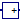 [AddX](OpenTEMPEST_Blocks_ComputationBlocks.md#opentempestblockscomputationblocksaddx)                                                                                     | Output the sum of the X inputs                                                                                                                                        |
|  [Poly](OpenTEMPEST_Blocks_ComputationBlocks.md#opentempestblockscomputationblockspoly)                                                                                     | Output a polynomical expression, y = c\[1\] + u\*(c\[2\] + u\*(c\[3\] + u\*(c\[4\] + ...)))                                                                           |
|  [AirFlowCalculation](OpenTEMPEST_Blocks_ComputationBlocks.md#opentempestblockscomputationblocksairflowcalculation)                                           | Air flow calculations for solid oxide cell systems                                                                                                                    |
|  [FuelFlowControl](OpenTEMPEST_Blocks_ComputationBlocks.md#opentempestblockscomputationblocksfuelflowcontrol)                                                    | Flow rate source for gas flows in electrochemical processes                                                                                                           |
|  [LimitBlock](OpenTEMPEST_Blocks_ComputationBlocks.md#opentempestblockscomputationblockslimitblock)                                                                   |                                                                                                                                                                       |
|  [ThermoneutralVoltageCalc](OpenTEMPEST_Blocks_ComputationBlocks.md#opentempestblockscomputationblocksthermoneutralvoltagecalc)                         |                                                                                                                                                                       |
|  [BumplessTransferController](OpenTEMPEST_Blocks_ComputationBlocks.md#opentempestblockscomputationblocksbumplesstransfercontroller)                   | Changes the setpoint of an external controller to reduce controller error peaks and toggles a switch between automatic and manual tracking for the reference variable |
|  [WGS_MSR_Equilibrium](OpenTEMPEST_Blocks_ComputationBlocks.md#opentempest-blocks-computationblocks-wgs_msr_equilibrium)                                     | Model computing equilibrium considering WGS and MSR reactions, for above 500°C                                                                                        |
|  [SlewRateLimiterVariable](OpenTEMPEST_Blocks_ComputationBlocks.md#opentempestblockscomputationblocksslewratelimitervariable)                            | Limits the slew rate of a signal                                                                                                                                      |
|  [FlowSafetyOffsetCalc](OpenTEMPEST_Blocks_ComputationBlocks.md#opentempestblockscomputationblocksflowsafetyoffsetcalc)                                     | Increases/descreases mass flow depending of the trend                                                                                                                 |
|  [vectorBumplessTransferController](OpenTEMPEST_Blocks_ComputationBlocks.md#opentempestblockscomputationblocksvectorbumplesstransfercontroller) | Changes the setpoint of an external controller to reduce controller error peaks and toggles a switch between automatic and manual tracking for the reference variable |
|  [GainVariable](OpenTEMPEST_Blocks_ComputationBlocks.md#opentempestblockscomputationblocksgainvariable)                                                             | Output the product of a gain value with the input signal                                                                                                              |

##  [OpenTEMPEST.Blocks.ComputationBlocks](OpenTEMPEST_Blocks_ComputationBlocks.md#opentempestblockscomputationblocks).Vf2Mf

Converts a volume flow into a mass flow

### Parameters

| Name | Description |
|------|-------------|
| TRef | \[K\]       |
| pRef | \[Pa\]      |
| M    | \[kg/mol\]  |

### Connectors

| Name | Description |
| ------| -------------|
| u    |             |
| y    |             |

## 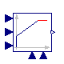 [OpenTEMPEST.Blocks.ComputationBlocks](OpenTEMPEST_Blocks_ComputationBlocks.md#opentempestblockscomputationblocks).LimPIDVariable

P, PI, PD, and PID controller with limited output, anti-windup compensation, setpoint weighting and optional feed-forward

### Information

Via parameter **controllerType** either **P**, **PI**, **PD**, or **PID** can be selected. If, e.g., PI is selected, all components belonging to the D-part are removed from the block (via conditional declarations). The example model Modelica.Blocks.Examples.PID_Controller demonstrates the usage of this controller. Several practical aspects of PID controller design are incorporated according to chapter 3 of the book:

Åström K.J., and Hägglund T.:  
**PID Controllers: Theory, Design, and Tuning**. Instrument Society of America, 2nd edition, 1995.

Besides the additive **proportional, integral** and **derivative** part of this controller, the following features are present:

- The output of this controller is limited. If the controller is in its limits, anti-windup compensation is activated to drive the integrator state to zero.
- The high-frequency gain of the derivative part is limited to avoid excessive amplification of measurement noise.
- Setpoint weighting is present, which allows to weight the setpoint in the proportional and the derivative part independently from the measurement. The controller will respond to load disturbances and measurement noise independently of this setting (parameters wp, wd). However, setpoint changes will depend on this setting. For example, it is useful to set the setpoint weight wd for the derivative part to zero, if steps may occur in the setpoint signal.
- Optional feed-forward. It is possible to add a feed-forward signal. The feed-forward signal is added before limitation.

The parameters of the controller can be manually adjusted by performing simulations of the closed loop system (= controller + plant connected together) and using the following strategy:

1.  Set very large limits, e.g., yMax = Modelica.Constants.inf
2.  Select a **P**-controller and manually enlarge parameter **k** (the total gain of the controller) until the closed-loop response cannot be improved any more.
3.  Select a **PI**-controller and manually adjust parameters **k** and **Ti** (the time constant of the integrator). The first value of Ti can be selected, such that it is in the order of the time constant of the oscillations occurring with the P-controller. If, e.g., vibrations in the order of T=10 ms occur in the previous step, start with Ti=0.01 s.
4.  If you want to make the reaction of the control loop faster (but probably less robust against disturbances and measurement noise) select a **PID**-Controller and manually adjust parameters **k**, **Ti**, **Td** (time constant of derivative block).
5.  Set the limits yMax and yMin according to your specification.
6.  Perform simulations such that the output of the PID controller goes in its limits. Tune **Ni** (Ni\*Ti is the time constant of the anti-windup compensation) such that the input to the limiter block (= limiter.u) goes quickly enough back to its limits. If Ni is decreased, this happens faster. If Ni=infinity, the anti-windup compensation is switched off and the controller works bad.

**Initialization**

This block can be initialized in different ways controlled by parameter **initType**. The possible values of initType are defined in Modelica.Blocks.Types.InitPID. This type is identical to Types.Init, with the only exception that the additional option **DoNotUse_InitialIntegratorState** is added for backward compatibility reasons (= integrator is initialized with InitialState whereas differential part is initialized with NoInit which was the initialization in version 2.2 of the Modelica standard library).

Based on the setting of initType, the integrator (I) and derivative (D) blocks inside the PID controller are initialized according to the following table:

[TABLE]

In many cases, the most useful initial condition is **SteadyState** because initial transients are then no longer present. If initType = InitPID.SteadyState, then in some cases difficulties might occur. The reason is the equation of the integrator:

       der(y) = k*u;

The steady state equation "der(x)=0" leads to the condition that the input u to the integrator is zero. If the input u is already (directly or indirectly) defined by another initial condition, then the initialization problem is **singular** (has none or infinitely many solutions). This situation occurs often for mechanical systems, where, e.g., u = desiredSpeed - measuredSpeed and since speed is both a state and a derivative, it is natural to initialize it with zero. As sketched this is, however, not possible. The solution is to not initialize u_m or the variable that is used to compute u_m by an algebraic equation.

When initializing in steady-state, homotopy-based initialization can help the convergence of the solver, by using a simplified model a the beginning of the solution process. Different options are available.

- **homotopyType=Linear** (default): the limitations are removed from the simplified model, making it linear. Use this if you know that the controller will not be saturated at steady state.
- **homotopyType=UpperLimit**: if it is known a priori the controller will be stuck at the upper limit yMax, this option assumes y = yMax as a simplified model.
- **homotopyType=LowerLimit**: if it is known a priori the controller will be stuck at the lower limit yMin, this option assumes y = yMin as a simplified model.
- **homotopyType=NoHomotopy**: this option does not apply any simplification and keeps the limiter active throughout the homotopy transformation. Use this if it is unknown whether the controller is saturated or not at initialization and if the limitations on the output must be enforced throughout the entire homotopy transformation.

The parameter **limitAtInit** is obsolete since MSL 3.2.2 and only kept for backwards compatibility.

Extends from Modelica.Blocks.Interfaces.SVcontrol (Single-Variable continuous controller).

### Parameters

| Name            | Description                                                                                                              |
| -----------------| --------------------------------------------------------------------------------------------------------------------------|
| controllerType  | Type of controller                                                                                                       |
| k               | Gain of controller \[1\]                                                                                                 |
| Ti              | Time constant of Integrator block \[s\]                                                                                  |
| Td              | Time constant of Derivative block \[s\]                                                                                  |
| wp              | Set-point weight for Proportional block (0..1)                                                                           |
| wd              | Set-point weight for Derivative block (0..1)                                                                             |
| Ni              | Ni\*Ti is time constant of anti-windup compensation                                                                      |
| Nd              | The higher Nd, the more ideal the derivative block                                                                       |
| withFeedForward | Use feed-forward input?                                                                                                  |
| kFF             | Gain of feed-forward input                                                                                               |
| Initialization  |                                                                                                                          |
| initType        | Type of initialization (1: no init, 2: steady state, 3: initial state, 4: initial output)                                |
| xi_start        | Initial or guess value for integrator output (= integrator state)                                                        |
| xd_start        | Initial or guess value for state of derivative block                                                                     |
| y_start         | Initial value of output                                                                                                  |
| homotopyType    | Simplified model for homotopy-based initialization                                                                       |
| Advanced        |                                                                                                                          |
| strict          | = true, if strict limits with noEvent(..)                                                                                |
| Dummy           |                                                                                                                          |
| limitsAtInit    | Has no longer an effect and is only kept for backwards compatibility (the implementation uses now the homotopy operator) |

### Connectors

| Name | Description                                     |
|------|-------------------------------------------------|
| u_s  | Connector of setpoint input signal              |
| u_m  | Connector of measurement input signal           |
| y    | Connector of actuator output signal             |
| u_ff | Optional connector of feed-forward input signal |
| yMax | Connector of setpoint input signal              |
| yMin | Connector of setpoint input signal              |

## 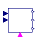 [OpenTEMPEST.Blocks.ComputationBlocks](OpenTEMPEST_Blocks_ComputationBlocks.md#opentempestblockscomputationblocks).TemperatureControllerV1

### Parameters

| Name     | Description |
|----------|-------------|
| TFuelMax | \[K\]       |
| TFuelMin | \[K\]       |
| TAirMax  | \[K\]       |
| TAirMin  | \[K\]       |
| mfAirMax | \[kg/s\]    |
| mfAirMin | \[kg/s\]    |
| TITIn    | \[K\]       |
| mfITAir  | \[kg/s\]    |

### Connectors

| Name     | Description                                     |
|----------|-------------------------------------------------|
| in_TITIn | 1 for maximum heating and 0 for maximum cooling |
| u        | 1 for maximum heating and 0 for maximum cooling |
| TFuel    |                                                 |
| TAir     |                                                 |
| mfAir    |                                                 |
| in_IT    | True isothermal operation if desired            |

## 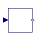 [OpenTEMPEST.Blocks.ComputationBlocks](OpenTEMPEST_Blocks_ComputationBlocks.md#opentempestblockscomputationblocks).Ploss

Is needed to take the power loss in PowerElectronics into account.

### Information

Extends from Modelica.Blocks.Interfaces.SISO (Single Input Single Output continuous control block).

### Parameters

| Name    | Description |
|---------|-------------|
| Pdesign | \[W\]       |
| a       |             |
| b       |             |
| c       |             |

### Connectors

| Name | Description                     |
|------|---------------------------------|
| u    | Connector of Real input signal  |
| y    | Connector of Real output signal |

## 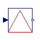 [OpenTEMPEST.Blocks.ComputationBlocks](OpenTEMPEST_Blocks_ComputationBlocks.md#opentempestblockscomputationblocks).PlossConverter

Is needed to take the power loss in PowerElectronics into account.

### Information

This model gives us the original power output from a DC/DC converter. we obtained a polynomial equation by implementing the curve fitting technique for the following curve obtained from the following literature: [https://doi.org/10.1016/j.ijhydene.2015.12.186](literature:https://doi.org/10.1016/j.ijhydene.2015.12.186)

DC/DC power conversion using GaNFets <https://www.e3s-conferences.org/articles/e3sconf/pdf/2017/04/e3sconf_espc2017_18003.pdf>

DC/DC power conversion using MoSFets <https://dspace.nwu.ac.za/handle/10394/34177>

\
The Ploss model calculates the power losses in a power converter based on the input power, design parameters, and the type of switching technology used (GaNFets or MOSFET).

|               |                                                      |
|---------------|------------------------------------------------------|
| Variable      | Description                                          |
| u             | Input power to the system                            |
| y             | caclculated total power loss                         |
| Pdesign       | Design power                                         |
| AC            | Boolean: true if the power source is AC, false if DC |
| converterType | Switching technology: GaNFets or MOSFET              |
| P             | input power to the model                             |
| PDCloss       | Power loss of DC/DC conversion                       |
| PACloss       | Power loss of the AC/DC conversion                   |
| Ploss         | Total Power loss                                     |

Extends from Modelica.Blocks.Interfaces.SISO (Single Input Single Output continuous control block), Modelica.Icons.UnderConstruction (Icon for classes that are still under construction).

### Parameters

| Name | Description |
|----|----|
| Pdesign | Design power in watts (only used in old modeltype) \[W\] |
| constACLoss | Rectifier/inverter loss constant if True, else pAC parameters used for 2nd order polynomial loss function. No loss for etaAC=1 |
| etaAC | If constACLoss=true. Constant rectifier/inverter loss |
| pAC\[3\] | If constACLoss=false. p\[1\]+x² + p\[2\]+x +p\[3\]. Default from fit to TNPC L5 IGBT curve in Fig 10 in DOI: 10.30420/566262171 |
| converterType | Select the type of converter |
| pGan_pos\[3\] | If converterType==GaNFets. p\[1\]+x² + p\[2\]+x +p\[3\] for pos. power range |
| pGan_neg\[3\] | If converterType==GaNFets. p\[1\]+x² + p\[2\]+x +p\[3\] for neg. power range |
| pMOS_pos\[3\] | If converterType==MOSFET. p\[1\]+x² + p\[2\]+x +p\[3\] for pos. power range |
| pMOS_neg\[3\] | If converterType==MOSFET. p\[1\]+x² + p\[2\]+x +p\[3\] for neg. power range |

### Connectors

| Name | Description                     |
|------|---------------------------------|
| u    | Connector of Real input signal  |
| y    | Connector of Real output signal |

## [OpenTEMPEST.Blocks.ComputationBlocks](OpenTEMPEST_Blocks_ComputationBlocks.md#opentempestblockscomputationblocks).HeatTransferCoefficientCalculator

### Parameters

| Name | Description |
|----|----|
| replaceable package Medium |   |
| p | Sink pressure \[Pa\] |
| T | Source temperature \[K\] |
| X\[Medium.nX\] | Gas composition \[kg/kg\] |
| mf | Mass flowrate \[kg/s\] |
| L | Flow channel length \[m\] |
| H | height of flow channel between two parallel plates \[m\] |
| W | width of flow channel between two parallel plates \[m\] |
| D | diameter of flow channel in a pipe \[m\] |
| pipe | = true if flow through a pipe, false if between two parallel plates |

### Connectors

| Name                       | Description |
|----------------------------|-------------|
| replaceable package Medium |             |

##  [OpenTEMPEST.Blocks.ComputationBlocks](OpenTEMPEST_Blocks_ComputationBlocks.md#opentempestblockscomputationblocks).Frac

Output the product of the n inputs

### Information

This blocks computes output **y** as *sum* of the three input signals **u1**, **u2** and **u3**:

        y = k1*u1 + k2*u2 + k3*u3;

Example:

         parameter:   k1= +2, k2= -3, k3=1;

      results in the following equations:

         y = 2 * u1 - 3 * u2 + u3;

Extends from Modelica.Blocks.Icons.Block (Basic graphical layout of input/output block).

### Parameters

| Name   | Description               |
|--------|---------------------------|
| n      | Number of input signals   |
| k\[n\] | Exponent of input signals |

### Connectors

| Name   | Description                     |
|--------|---------------------------------|
| u\[n\] | Connector of Real input signals |
| y      | Connector of Real output signal |

## 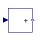 [OpenTEMPEST.Blocks.ComputationBlocks](OpenTEMPEST_Blocks_ComputationBlocks.md#opentempestblockscomputationblocks).AddX

Output the sum of the X inputs

### Information

This blocks computes output **y** as *sum* of the three input signals **u1**, **u2** and **u3**:

        y = k1*u1 + k2*u2 + k3*u3;

Example:

         parameter:   k1= +2, k2= -3, k3=1;

      results in the following equations:

         y = 2 * u1 - 3 * u2 + u3;

Extends from Modelica.Blocks.Icons.Block (Basic graphical layout of input/output block).

### Parameters

| Name   | Description             |
| --------| -------------------------|
| n      | Number of input signals |
| k\[n\] | Gain of input signals   |

### Connectors

| Name   | Description                      |
|--------|----------------------------------|
| u\[n\] | Connectors of Real input signals |
| y      | Connector of Real output signal  |

##  [OpenTEMPEST.Blocks.ComputationBlocks](OpenTEMPEST_Blocks_ComputationBlocks.md#opentempestblockscomputationblocks).Poly

Output a polynomical expression, y = c\[1\] + u\*(c\[2\] + u\*(c\[3\] + u\*(c\[4\] + ...)))

### Information

This blocks computes output **y** as *sum* of the three input signals **u1**, **u2** and **u3**:

        y = k1*u1 + k2*u2 + k3*u3;

Example:

         parameter:   k1= +2, k2= -3, k3=1;

      results in the following equations:

         y = 2 * u1 - 3 * u2 + u3;

Extends from Modelica.Blocks.Interfaces.SISO (Single Input Single Output continuous control block).

### Parameters

| Name   | Description             |
|--------|-------------------------|
| c\[:\] | Polynomial coefficients |

### Connectors

| Name | Description                     |
|------|---------------------------------|
| u    | Connector of Real input signal  |
| y    | Connector of Real output signal |

## 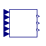 [OpenTEMPEST.Blocks.ComputationBlocks](OpenTEMPEST_Blocks_ComputationBlocks.md#opentempestblockscomputationblocks).AirFlowCalculation

Air flow calculations for solid oxide cell systems

### Information

Extends from Modelica.Blocks.Icons.Block (Basic graphical layout of input/output block).

### Parameters

| Name                       | Description                                    |
|----------------------------|------------------------------------------------|
| replaceable package Medium |                                                |
| nCells                     | Number of cells that are fed by this source    |
| I0                         | Nominal electrical current \[A\]               |
| OU0                        | Nominal oxygen utilization                     |
| yO2Out0                    | Nominal outlet oxygen molar compostion         |
| lambdaSF0                  | Nominal air number (lambda, sunfire style)     |
| zFuel0                     | Nominal zFuel                                  |
| mfMin                      | Minimum mass flow \[kg/s\]                     |
| External inputs            |                                                |
| use_in_I                   | Use connector input for the electrical current |
| use_in_OU                  | Use connector input for the oxygen utilization |
| use_in_yO2Out              | Use connector input for yO2Out                 |
| use_in_lambdaSF            | Use connector input for lambdaSF               |
| use_in_zFuel               | Use connector input for zFuel                  |

### Connectors

| Name | Description |
|----|----|
| replaceable package Medium |   |
| in_I | Current input \[A\] |
| in_OU | oxygen utilization input |
| in_yO2Out | oulet oxygen molar compostion |
| in_lambdaSF | air number (lambda, sunfire style) |
| in_zFuel | zFuel |
| out_mfAirOU | air mass flow based on oxygen utilization (OU) \[kg/s\] |
| out_mfAirOutletO2 | air mass flow based on oxygen outlet molar fraction \[kg/s\] |
| out_mfAirLambdaSF | air mass flow based on air number (λsf, sunfire style) \[kg/s\] |

## 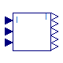 [OpenTEMPEST.Blocks.ComputationBlocks](OpenTEMPEST_Blocks_ComputationBlocks.md#opentempestblockscomputationblocks).FuelFlowControl

Flow rate source for gas flows in electrochemical processes

### Information

**Modelling options**

The actual gas used in the component is determined by the replaceable `Medium` package. In the case of multiple component, variable composition gases, the nominal gas composition is given by `Xnom`,whose default value is `Medium.reference_X` .

If `G` is set to zero, the flowrate source is ideal; otherwise, the outgoing flowrate decreases proportionally to the outlet pressure.

If the `in_w0` connector is wired, then the source massflowrate is given by the corresponding signal, otherwise it is fixed to `w0`.

If the `in_T` connector is wired, then the source temperature is given by the corresponding signal, otherwise it is fixed to `T`.

If the `in_X` connector is wired, then the source massfraction is given by the corresponding signal, otherwise it is fixed to `Xnom`.

Extends from Modelica.Blocks.Icons.Block (Basic graphical layout of input/output block).

### Parameters

| Name | Description |
|----|----|
| replaceable package Medium |   |
| compositionNom\[Medium.nX\] | Nominal gas composition |
| FormingGasComposition\[Medium.nX\] | Secondary or Forming Gas composition (default 5/95) |
| molarInputComposition | Input compostions are molar instead of mass |
| I0 | Nominal electrical current \[A\] |
| RC0 | Nominal reactant conversion |
| nCells | Number of cells that are fed by this source |
| tSmooth | Base time constant for PT1 output smoothing \[s\] |
| mfStart | Initial value for the mass flow \[kg/s\] |
| IStart | Initial value for the current \[A\] |
| zFC\[Medium.nX\] |   |
| zEC\[Medium.nX\] |   |
| Minimal flow |  |
| minCurrentForDosing | Minimal absolute current to calculate flows based on current \[A\] |
| doseFGUnderIMin | Use forming gas (FormingGasComposition) instead of given compostion if flow is below minimal current |
| mfFGPerCell | Forming gas (FormingGasComposition) mass flow per cell at 0 A if activated \[kg/s\] |
| External inputs |  |
| use_in_I | Use connector input for the electrical current |
| use_in_RC | Use connector input for the reactant conversion |
| use_in_composition | Use connector input for the composition |
| Calculated parameter |  |
| Xnom\[Medium.nX\] | Nominal gas composition \[kg/kg\] |
| Ynom\[Medium.nX\] | Nominal gas composition \[mol/mol\] |

### Connectors

| Name                        | Description |
|-----------------------------|-------------|
| replaceable package Medium  |             |
| in_I                        |             |
| in_RC                       |             |
| in_composition\[Medium.nX\] |             |
| out_y\[Medium.nX\]          |             |
| out_I                       |             |
| out_mf                      |             |
| out_x\[Medium.nX\]          |             |
| out_mfi\[Medium.nX\]        |             |

##  [OpenTEMPEST.Blocks.ComputationBlocks](OpenTEMPEST_Blocks_ComputationBlocks.md#opentempestblockscomputationblocks).LimitBlock

### Information

This blocks computes output **y** as *sum* of the three input signals **u1**, **u2** and **u3**:

        y = k1*u1 + k2*u2 + k3*u3;

Example:

         parameter:   k1= +2, k2= -3, k3=1;

      results in the following equations:

         y = 2 * u1 - 3 * u2 + u3;

Extends from Modelica.Blocks.Icons.Block (Basic graphical layout of input/output block).

### Parameters

| Name   | Description |
|--------|-------------|
| minVal |             |
| maxVal |             |

### Connectors

| Name | Description                     |
|------|---------------------------------|
| u    | Connector of Real input signals |
| y    | Connector of Real output signal |

## 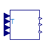 [OpenTEMPEST.Blocks.ComputationBlocks](OpenTEMPEST_Blocks_ComputationBlocks.md#opentempestblockscomputationblocks).ThermoneutralVoltageCalc

### Information

Extends from Modelica.Blocks.Icons.Block (Basic graphical layout of input/output block).

### Connectors

| Name    | Description   |
|---------|---------------|
| in_T    |               |
| out_UTN |               |
| in_YH2O | Current input |
| in_YCO2 | Current input |
| out_UId |               |
| in_YH2  | Current input |
| out_ASR |               |

## 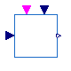 [OpenTEMPEST.Blocks.ComputationBlocks](OpenTEMPEST_Blocks_ComputationBlocks.md#opentempestblockscomputationblocks).BumplessTransferController

Changes the setpoint of an external controller to reduce controller error peaks and toggles a switch between automatic and manual tracking for the reference variable

### Information

The model is created to achieve a smooth transition between two signals: it is originally tought for manual/automatic tracking for a controller, but then generalized to take any kind of signals. It requires two real inputs (setPoint1 and setPoint2), and a boolean input (in_setPoint2Active) that when TRUE will use setPoint2, and when false setPoint1. The transition is regulated by a ramp that smoothen the differences between the signal, and the tuning parameter is the duration of said ramp (rampCompensatorDuration)

### Parameters

| Name                    | Description                       |
|-------------------------|-----------------------------------|
| rampCompensatorDuration | Ramp Compensator duration \[s\]   |
| rampStartTime           | Ramp Compensator start time \[s\] |

### Connectors

| Name                 | Description                               |
|----------------------|-------------------------------------------|
| out_setPointVariable |                                           |
| in_setPoint2         |                                           |
| in_setPoint1         |                                           |
| in_setPoint2Active   | Trigger for activation of manual tracking |

## 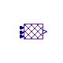 [OpenTEMPEST.Blocks.ComputationBlocks](OpenTEMPEST_Blocks_ComputationBlocks.md#opentempestblockscomputationblocks).WGS_MSR_Equilibrium

Model computing equilibrium considering WGS and MSR reactions, for above 500°C

### Information

Calculates the equilibrium for given, yIn, T, p, considering water gas shift and methane reforming reactions.

### Connectors

| Name                         | Description       |
|------------------------------|-------------------|
| in_composition\[Medium.nX\]  | mass fractions    |
| in_T                         | Temperature in °C |
| in_p                         | pressure in Pa    |
| out_composition\[Medium.nX\] |                   |

## 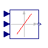 [OpenTEMPEST.Blocks.ComputationBlocks](OpenTEMPEST_Blocks_ComputationBlocks.md#opentempestblockscomputationblocks).SlewRateLimiterVariable

Limits the slew rate of a signal

### Information

The `SlewRateLimiter` block limits the slew rate of its input signal in the range of `[Falling, Rising]`.

To ensure this for arbitrary inputs and in order to produce a differential output, the input is numerically differentiated with derivative time constant `Td`. Smaller time constant `Td` means nearer ideal derivative.

*Note: The user has to choose the derivative time constant according to the nature of the input signal.*

Extends from Modelica.Blocks.Interfaces.SISO (Single Input Single Output continuous control block).

### Parameters

| Name           | Description                                        |
|----------------|----------------------------------------------------|
| Td             | Derivative time constant \[s\]                     |
| Initialization |                                                    |
| initType       | Type of initialization (SteadyState implies y = u) |
| y_start        | Initial or guess value of output (= state)         |
| Advanced       |                                                    |
| strict         | = true, if strict limits with noEvent(..)          |

### Connectors

| Name    | Description                                       |
|---------|---------------------------------------------------|
| u       | Connector of Real input signal                    |
| y       | Connector of Real output signal                   |
| Rising  | Maximum rising slew rate \[+small..+inf) \[1/s\]  |
| Falling | Maximum falling slew rate (-inf..-small\] \[1/s\] |

##  [OpenTEMPEST.Blocks.ComputationBlocks](OpenTEMPEST_Blocks_ComputationBlocks.md#opentempestblockscomputationblocks).FlowSafetyOffsetCalc

Increases/descreases mass flow depending of the trend

### Information

Extends from Modelica.Blocks.Interfaces.SISO (Single Input Single Output continuous control block).

### Parameters

| Name        | Description                                        |
|-------------|----------------------------------------------------|
| tPrediction | Time the offset is calcualted for \[s\]            |
| tPt1        | Time constant of the PT1 block for smoothing \[s\] |
| yStart      | Start value of the output                          |
| minVal      | Min value of the output                            |
| maxVal      | Max value of the output                            |

### Connectors

| Name | Description                     |
|------|---------------------------------|
| u    | Connector of Real input signal  |
| y    | Connector of Real output signal |

##  [OpenTEMPEST.Blocks.ComputationBlocks](OpenTEMPEST_Blocks_ComputationBlocks.md#opentempestblockscomputationblocks).vectorBumplessTransferController

Changes the setpoint of an external controller to reduce controller error peaks and toggles a switch between automatic and manual tracking for the reference variable

### Information

The model is created to achieve a smooth transition between two signals: it is originally tought for manual/automatic tracking for a controller, but then generalized to take any kind of signals. It requires two real inputs (setPoint1 and setPoint2), and a boolean input (in_setPoint2Active) that when TRUE will use setPoint2, and when false setPoint1. The transition is regulated by a ramp that smoothen the differences between the signal, and the tuning parameter is the duration of said ramp (rampCompensatorDuration)

### Parameters

| Name                    | Description                       |
|-------------------------|-----------------------------------|
| rampCompensatorDuration | Ramp Compensator duration \[s\]   |
| rampStartTime           | Ramp Compensator start time \[s\] |
| n                       | Number of vector in-/outputs      |

### Connectors

| Name                      | Description                               |
|---------------------------|-------------------------------------------|
| out_setPointVariable\[n\] |                                           |
| in_setPoint2\[n\]         |                                           |
| in_setPoint1\[n\]         |                                           |
| in_setPoint2Active        | Trigger for activation of manual tracking |

## 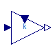 [OpenTEMPEST.Blocks.ComputationBlocks](OpenTEMPEST_Blocks_ComputationBlocks.md#opentempestblockscomputationblocks).GainVariable

Output the product of a gain value with the input signal

### Information

This block computes output *y* as *product* of gain *k* with the input *u*:

        y = k * u;

### Parameters

| Name            | Description                                   |
| -----------------| -----------------------------------------------|
| k               | Gain value multiplied with input signal \[1\] |
| External inputs |                                               |
| use_in_k        | Use connector input for the composition       |

### Connectors

| Name | Description             |
| ------| -------------------------|
| u    | Input signal connector  |
| y    | Output signal connector |
| in_k | Input signal connector  |

[Automatically generated](http://www.3ds.com/) Sun Sep 20 19:09:46 2026.
