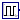
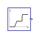
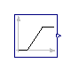
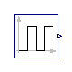
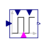

## [OpenTEMPEST.Blocks](OpenTEMPEST_Blocks.md#opentempestblocks).Sources

### Package Content

| Name | Description |
|----|----|
|  [MultiRamp](OpenTEMPEST_Blocks_Sources.md#opentempestblockssourcesmultiramp) | Generate signal with n ramps |
|  [VectorRamp](OpenTEMPEST_Blocks_Sources.md#opentempestblockssourcesvectorramp) |   |
|  [Pulse](OpenTEMPEST_Blocks_Sources.md#opentempestblockssourcespulse) | Generate pulses - faster than MSL pulse source. Uses MultiRamp in the background |
|  [PulseVar](OpenTEMPEST_Blocks_Sources.md#opentempestblockssourcespulsevar) |   |
|  [RealExpressionArray](OpenTEMPEST_Blocks_Sources.md#opentempestblockssourcesrealexpressionarray) | Set output signal to a time varying Real expression |

##  [OpenTEMPEST.Blocks.Sources](OpenTEMPEST_Blocks_Sources.md#opentempestblockssources).MultiRamp

Generate signal with n ramps

### Information

The Real output y is a ramp signal:

If parameter duration is set to 0.0, the limiting case of a Step signal is achieved.

Extends from Modelica.Blocks.Interfaces.SO (Single Output continuous control block).

### Parameters

| Name           | Description                                 |
|----------------|---------------------------------------------|
| n              | number of ramps                             |
| height\[n\]    | Height of ramps                             |
| duration\[n\]  | Duration of ramp (= 0.0 gives a Step) \[s\] |
| offset         | Offset of output signal                     |
| startTime\[n\] | Output = offset for time \< startTime \[s\] |

### Connectors

| Name | Description                     |
|------|---------------------------------|
| y    | Connector of Real output signal |

##  [OpenTEMPEST.Blocks.Sources](OpenTEMPEST_Blocks_Sources.md#opentempestblockssources).VectorRamp

### Information

Extends from Modelica.Blocks.Interfaces.MO (Multiple Output continuous control block).

### Parameters

| Name           | Description                                 |
|----------------|---------------------------------------------|
| height\[nout\] | Height of ramps                             |
| target\[nout\] | Target of the output signals                |
| duration       | Duration of ramp (= 0.0 gives a Step) \[s\] |
| offset\[nout\] | Offset of output signals                    |
| startTime      | Output = offset for time \< startTime \[s\] |
| nout           | Number of outputs                           |

### Connectors

| Name      | Description                      |
|-----------|----------------------------------|
| y\[nout\] | Connector of Real output signals |

##  [OpenTEMPEST.Blocks.Sources](OpenTEMPEST_Blocks_Sources.md#opentempestblockssources).Pulse

Generate pulses - faster than MSL pulse source. Uses MultiRamp in the background

### Information

The Real output y is a ramp signal:

If parameter duration is set to 0.0, the limiting case of a Step signal is achieved.

Extends from Modelica.Blocks.Interfaces.SO (Single Output continuous control block).

### Parameters

| Name          | Description                                  |
|---------------|----------------------------------------------|
| nPulse        | Number of Pulses                             |
| pulseHeight   | Height of Pulse                              |
| startPulse    | \[s\]                                        |
| pulseDuration | Time for one period (onTime + offtime) \[s\] |
| dutyCycle     | Width of Pulse (0 to 1)                      |
| offset        | Offset of output signal                      |

##  [OpenTEMPEST.Blocks.Sources](OpenTEMPEST_Blocks_Sources.md#opentempestblockssources).PulseVar

### Connectors

| Name      | Description |
|-----------|-------------|
| y         |             |
| duration  |             |
| duty      |             |
| Amplitude |             |
| pulseOn   |             |

##  [OpenTEMPEST.Blocks.Sources](OpenTEMPEST_Blocks_Sources.md#opentempestblockssources).RealExpressionArray

Set output signal to a time varying Real expression

### Information

The (time varying) Real output signal of this block can be defined in its parameter menu via variable **y**. The purpose is to support the easy definition of Real expressions in a block diagram. For example, in the y-menu the definition "if time \< 1 then 0 else 1" can be given in order to define that the output signal is one, if time ≥ 1 and otherwise it is zero. Note, that "time" is a built-in variable that is always accessible and represents the "model time" and that variable **y** is both a variable and a connector.

### Parameters

| Name | Description |
|----|----|
| nAxes | number of axes of output array y |
| arrayOut\[nAxes\] | shape of output array y |
| Time varying output signal |  |
| y\[arrayOut\[1\], arrayOut\[2\], arrayOut\[3\], arrayOut\[4\]\] | Values of Real output array y |

### Connectors

| Name | Description |
|----|----|
| Time varying output signal |  |
| y\[arrayOut\[1\], arrayOut\[2\], arrayOut\[3\], arrayOut\[4\]\] | Values of Real output array y |

[Automatically generated](http://www.3ds.com/) Sun Sep 20 19:09:45 2026.
