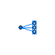
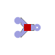
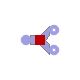
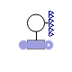
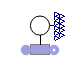
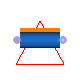
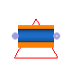
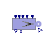

## [OpenTEMPEST](OpenTEMPEST.md#opentempest).Flow

### Package Content

| Name | Description |
|----|----|
|  [Manifold_out](OpenTEMPEST_Flow.md#opentempest-flow-manifold_out) |   |
|  [Manifold](OpenTEMPEST_Flow.md#opentempestflowmanifold) |   |
|  [FluxInterpolators](OpenTEMPEST_Flow_FluxInterpolators.md#opentempestflowfluxinterpolators) |   |
|  [BaseClasses](OpenTEMPEST_Flow_BaseClasses.md#opentempestflowbaseclasses) |   |
|  [gasHeaterAndJoiner](OpenTEMPEST_Flow.md#opentempestflowgasheaterandjoiner) |   |
|  [MultiSplitter](OpenTEMPEST_Flow.md#opentempestflowmultisplitter) |   |
|  [ForcedFlowMultiSplitter](OpenTEMPEST_Flow.md#opentempestflowforcedflowmultisplitter) |   |
|  [MultiJoin](OpenTEMPEST_Flow.md#opentempestflowmultijoin) |   |
|  [GasHeatedSplitter](OpenTEMPEST_Flow.md#opentempestflowgasheatedsplitter) |   |
|  [SensGasFlow](OpenTEMPEST_Flow.md#opentempestflowsensgasflow) | Sensor for flow parameters of gas flows |
|  [SensGasProperty](OpenTEMPEST_Flow.md#opentempestflowsensgasproperty) |   |
|  [LambdaSensor](OpenTEMPEST_Flow.md#opentempestflowlambdasensor) | "Enter Desc" |
|  [Flow1D](OpenTEMPEST_Flow.md#opentempestflowflow1d) | 1D flow model FVM, uses UDS and LUDS |
|  [Flow1D2w](OpenTEMPEST_Flow.md#opentempestflowflow1d2w) |   |
|  [PressDropLin](OpenTEMPEST_Flow.md#opentempestflowpressdroplin) | added dp calculation in thermopower pressure drop lin |
|  [SourceMassFlowEC](OpenTEMPEST_Flow.md#opentempestflowsourcemassflowec) | Flow rate source for gas flows in electrochemical processes |
|  [ThreeWayValve](OpenTEMPEST_Flow.md#opentempestflowthreewayvalve) | time controlled three-way valve for switching between two flow paths 'purge' and 'use' |

##  [OpenTEMPEST.Flow](OpenTEMPEST_Flow.md#opentempestflow).Manifold_out

### Parameters

| Name                       | Description |
|----------------------------|-------------|
| replaceable package Medium |             |

### Connectors

| Name                       | Description |
|----------------------------|-------------|
| replaceable package Medium |             |
| ports_a\[nPorts_a\]        |             |
| port_b                     |             |

##  [OpenTEMPEST.Flow](OpenTEMPEST_Flow.md#opentempestflow).Manifold

### Parameters

| Name                       | Description |
|----------------------------|-------------|
| replaceable package Medium |             |

### Connectors

| Name                       | Description |
|----------------------------|-------------|
| replaceable package Medium |             |
| port_a                     |             |
| ports_b\[nPorts_b\]        |             |

##  [OpenTEMPEST.Flow](OpenTEMPEST_Flow.md#opentempestflow).gasHeaterAndJoiner

### Parameters

| Name | Description |
|----|----|
| replaceable package medium |   |
| pipe\[3\] | = true if flow through a pipe, false if between two parallel plates |
| nParallel\[3\] | number of parallel flow ducts |
| l\[3\] | lenght of flow channel \[m\] |
| h\[3\] | height of flow channel between two parallel plates \[m\] |
| w\[3\] | width of flow channel between two parallel plates \[m\] |
| d\[3\] | diameter of flow channel in a pipe \[m\] |
| maximalFlow | maximal mass flow rate \[kg/s\] |
| Initialization |  |
| TStart | cell Starting inlet temperature for simulation \[K\] |
| pStart | cell Starting Pressure \[Pa\] |
| XStart\[medium.nX\] | \[1\] |

### Connectors

| Name                       | Description |
|----------------------------|-------------|
| replaceable package medium |             |
| inletA                     |             |
| outlet                     |             |
| ht\[3\]                    |             |
| inletB                     |             |

##  [OpenTEMPEST.Flow](OpenTEMPEST_Flow.md#opentempestflow).MultiSplitter

### Parameters

| Name                       | Description |
|----------------------------|-------------|
| nOutlets                   |             |
| replaceable package Medium |             |

### Connectors

| Name                       | Description |
|----------------------------|-------------|
| replaceable package Medium |             |
| outlet\[nOutlets\]         |             |
| inlet                      |             |

##  [OpenTEMPEST.Flow](OpenTEMPEST_Flow.md#opentempestflow).ForcedFlowMultiSplitter

### Parameters

| Name                       | Description |
|----------------------------|-------------|
| nOutlets                   |             |
| replaceable package Medium |             |

### Connectors

| Name                       | Description |
|----------------------------|-------------|
| replaceable package Medium |             |
| inlet                      |             |
| outlet\[nOutlets\]         |             |

##  [OpenTEMPEST.Flow](OpenTEMPEST_Flow.md#opentempestflow).MultiJoin

### Parameters

| Name                       | Description |
|----------------------------|-------------|
| nInlets                    |             |
| replaceable package Medium |             |

### Connectors

| Name                       | Description |
|----------------------------|-------------|
| replaceable package Medium |             |
| outlet                     |             |
| inlet\[nInlets\]           |             |

##  [OpenTEMPEST.Flow](OpenTEMPEST_Flow.md#opentempestflow).GasHeatedSplitter

### Parameters

| Name | Description |
|----|----|
| replaceable package medium |   |
| outletAShare |   |
| pipe\[3\] | = true if flow through a pipe, false if between two parallel plates |
| nParallel\[3\] | number of parallel flow ducts |
| l\[3\] | lenght of flow channel \[m\] |
| h\[3\] | height of flow channel between two parallel plates \[m\] |
| w\[3\] | width of flow channel between two parallel plates \[m\] |
| d\[3\] | diameter of flow channel in a pipe \[m\] |
| maximalFlow | maximal mass flow rate \[kg/s\] |
| Initialization |  |
| TStart | cell Starting inlet temperature for simulation \[K\] |
| pStart | cell Starting Pressure \[Pa\] |
| XStart\[medium.nX\] | \[1\] |

### Connectors

| Name                       | Description |
|----------------------------|-------------|
| replaceable package medium |             |
| inlet                      |             |
| outletA                    |             |
| outletB                    |             |
| ht\[3\]                    |             |

##  [OpenTEMPEST.Flow](OpenTEMPEST_Flow.md#opentempestflow).SensGasFlow

Sensor for flow parameters of gas flows

### Information

This component can be inserted in a hydraulic circuit to measure the flowrate of the fluid flowing through it.

Flow reversal is supported.

Extends from ThermoPower.Icons.Gas.SensThrough.

### Parameters

| Name | Description |
|----|----|
| mfOutput | Sensor has output for mass flow |
| pOutput | Sensor has output for pressure flow |
| hOutput | Sensor has output for enthalpy flow |
| XOutput | Sensor has output for mass fractions |
| YOutput | Sensor has output for molar fractions |
| HfOutput | Sensor has output for enthalpy flow |
| nfOutput | Sensor has output for molar flow |
| replaceable package Medium |   |
| allowFlowReversal | = true to allow flow reversal, false restricts to design direction |

### Connectors

| Name                       | Description |
|----------------------------|-------------|
| replaceable package Medium |             |
| inlet                      |             |
| outlet                     |             |
| Hf                         |             |
| mf                         |             |
| p                          |             |
| h                          |             |
| x\[Medium.nXi\]            |             |
| y\[Medium.nXi\]            |             |
| nf                         |             |

##  [OpenTEMPEST.Flow](OpenTEMPEST_Flow.md#opentempestflow).SensGasProperty

### Information

Extends from [OpenTEMPEST.Flow.SensGasFlow](OpenTEMPEST_Flow.md#opentempestflowsensgasflow) (Sensor for flow parameters of gas flows).

### Parameters

| Name | Description |
|----|----|
| mfOutput | Sensor has output for mass flow |
| pOutput | Sensor has output for pressure flow |
| hOutput | Sensor has output for enthalpy flow |
| XOutput | Sensor has output for mass fractions |
| YOutput | Sensor has output for molar fractions |
| HfOutput | Sensor has output for enthalpy flow |
| nfOutput | Sensor has output for molar flow |
| replaceable package Medium |   |
| allowFlowReversal | = true to allow flow reversal, false restricts to design direction |
| cpOutput | Sensor has output for the heat capacity |
| lambdaOutput | Sensor has output for the thermal conductivity |
| etaOutput | Sensor has output for the dynamic viscosity |
| TOutput | Sensor has output for the temperature |
| rhoOutput | Sensor has output for the density |
| Initialisation |  |
| pstart | Pressure start value \[Pa\] |
| Tstart | Temperature start value \[K\] |
| Xstart\[Medium.nX\] | Start gas composition \[kg/kg\] |

### Connectors

| Name            | Description            |
|-----------------|------------------------|
| inlet           |                        |
| outlet          |                        |
| Hf              |                        |
| mf              |                        |
| p               |                        |
| h               |                        |
| x\[Medium.nXi\] |                        |
| y\[Medium.nXi\] |                        |
| nf              |                        |
| cp              | specificHeatCapacityCp |
| lambda          | thermalConductivity    |
| eta             | dynamicViscosity       |
| T               | Temperature \[K\]      |
| rho             | density                |

##  [OpenTEMPEST.Flow](OpenTEMPEST_Flow.md#opentempestflow).LambdaSensor

"Enter Desc"

### Parameters

| Name                     | Description |
|--------------------------|-------------|
| replaceable package Fuel |             |

### Connectors

| Name                     | Description |
|--------------------------|-------------|
| replaceable package Fuel |             |
| xmass_out\[Fuel.nX\]     |             |
| xmass_in\[Fuel.nX\]      |             |
| N_cells                  |             |
| I                        |             |

##  [OpenTEMPEST.Flow](OpenTEMPEST_Flow.md#opentempestflow).Flow1D

1D flow model FVM, uses UDS and LUDS

### Information

Extends from Modelica.Icons.UnderConstruction (Icon for classes that are still under construction), [OpenTEMPEST.Flow.BaseClasses.Flow1DBaseClass](OpenTEMPEST_Flow_BaseClasses.md#opentempestflowbaseclassesflow1dbaseclass) (Base class model for 1D flow model based on FVM or FDM. Can be used to build PFR models or heterogeneous catalytic reactor models).

### Parameters

| Name | Description |
|----|----|
| replaceable package Medium |   |
| N |   |
| Ntubes | number of individual tubes |
| dpdxNom | Pressure drop in pipe Pa/m |
| LUDS | Set true for linear upwind differencing |
| internalHT | set true if you want to model HT phenomena inside the channel, false for HT modelled outside |
| h_conv | Heat Transfer Coefficient /W/m2/K \[W/(m2.K)\] |
| Initialisation |  |
| TStartIn | \[K\] |
| TStartOut | \[K\] |
| TStart\[N\] | \[K\] |
| pStart | \[Pa\] |
| xStart\[nSpecies\] | \[1\] |
| Dimensions |  |
| Rh | Hydraulic Radius single channel (Dh/2) /m \[m\] |
| omega | Wetted Perimeter single channel /m \[m\] |
| theta0_1 | Proportion of entrance and exit volumes to centre volumes /- |
| L | Length of pipe /m \[m\] |
| Acs | channel cross sectional area \[m2\] |
| Aw | HT area for one CV single channel \[m2\] |
| theta\[N, 1\] | coefficient for CV size |
| dV | Size of nominal control volume /m3 \[m3\] |
| dx | length of nominal 1D control volume /m \[m\] |

### Connectors

| Name  | Description                 |
|-------|-----------------------------|
| infl  |                             |
| outfl |                             |
| wall  | HT through cylindrical wall |

##  [OpenTEMPEST.Flow](OpenTEMPEST_Flow.md#opentempestflow).Flow1D2w

### Information

Extends from [OpenTEMPEST.Flow.Flow1D](OpenTEMPEST_Flow.md#opentempestflowflow1d) (1D flow model FVM, uses UDS and LUDS).

### Parameters

| Name | Description |
|----|----|
| replaceable package Medium |   |
| N |   |
| Ntubes | number of individual tubes |
| dpdxNom | Pressure drop in pipe Pa/m |
| LUDS | Set true for linear upwind differencing |
| internalHT | set true if you want to model HT phenomena inside the channel, false for HT modelled outside |
| h_conv | Heat Transfer Coefficient /W/m2/K \[W/(m2.K)\] |
| Qext\[N\] |   |
| Initialisation |  |
| TStartIn | \[K\] |
| TStartOut | \[K\] |
| TStart\[N\] | \[K\] |
| pStart | \[Pa\] |
| xStart\[nSpecies\] | \[1\] |
| Dimensions |  |
| Rh | Hydraulic Radius single channel (Dh/2) /m \[m\] |
| omega | Wetted Perimeter single channel /m \[m\] |
| theta0_1 | Proportion of entrance and exit volumes to centre volumes /- |
| L | Length of pipe /m \[m\] |
| Acs | channel cross sectional area \[m2\] |
| Aw | HT area for one CV single channel \[m2\] |
| theta\[N, 1\] | coefficient for CV size |
| dV | Size of nominal control volume /m3 \[m3\] |
| dx | length of nominal 1D control volume /m \[m\] |

### Connectors

| Name  | Description                 |
|-------|-----------------------------|
| infl  |                             |
| outfl |                             |
| wall  | HT through cylindrical wall |
| wall2 |                             |

##  [OpenTEMPEST.Flow](OpenTEMPEST_Flow.md#opentempestflow).PressDropLin

added dp calculation in thermopower pressure drop lin

### Information

Extends from ThermoPower.Gas.PressDropLin (Linear pressure drop for gas flows).

### Parameters

| Name | Description |
|----|----|
| replaceable package Medium |   |
| R | Hydraulic resistance \[Pa/(kg/s)\] |
| allowFlowReversal | = true to allow flow reversal, false restricts to design direction |

### Connectors

| Name   | Description |
|--------|-------------|
| inlet  |             |
| outlet |             |

##  [OpenTEMPEST.Flow](OpenTEMPEST_Flow.md#opentempestflow).SourceMassFlowEC

Flow rate source for gas flows in electrochemical processes

### Information

**Modelling options**

The actual gas used in the component is determined by the replaceable `Medium` package. In the case of multiple component, variable composition gases, the nominal gas composition is given by `Xnom`,whose default value is `Medium.reference_X` .

If `G` is set to zero, the flowrate source is ideal; otherwise, the outgoing flowrate decreases proportionally to the outlet pressure.

If the `in_w0` connector is wired, then the source massflowrate is given by the corresponding signal, otherwise it is fixed to `w0`.

If the `in_T` connector is wired, then the source temperature is given by the corresponding signal, otherwise it is fixed to `T`.

If the `in_X` connector is wired, then the source massfraction is given by the corresponding signal, otherwise it is fixed to `Xnom`.

Extends from ThermoPower.Icons.Gas.SourceW.

### Parameters

| Name | Description |
|----|----|
| replaceable package Medium |   |
| p0 | Nominal pressure \[Pa\] |
| T | Nominal temperature \[K\] |
| TSteamMin | Minimum temperature of the steam \[K\] |
| compositionNom\[Medium.nX\] | Nominal gas composition |
| FormingGasComposition\[Medium.nX\] | Secondary or Forming Gas composition (default 5/95) |
| molarInputComposition | Input compostions are molar instead of mass |
| I0 | Nominal electrical current \[A\] |
| RC0 | Nominal reactant conversion |
| G | HydraulicConductance \[(kg/s)/Pa\] |
| allowFlowReversal | = true to allow flow reversal, false restricts to design direction |
| nCells | Number of cells that are fed by this source |
| minH2OXiforIout | Minimum H2/H2O (FC/EC) Massfraction for current signal to pass on \[1\] |
| Minimal flow |  |
| minCurrentForDosing | Minimal absolute current to calculate flows based on current \[A\] |
| doseFGUnderIMin | Use forming gas (FormingGasComposition) instead of given compostion if flow is below minimal current |
| mfFGPerCell | Forming gas (FormingGasComposition) mass flow per cell at 0 A if activated \[kg/s\] |
| External inputs |  |
| use_in_I | Use connector input for the electrical current |
| use_in_RC | Use connector input for the reactant conversion |
| use_in_T | Use connector input for the temperature |
| use_in_composition | Use connector input for the composition |
| use_in_mfFGPerCell | Use connector input for mfFGPerCell |
| Calculated parameter |  |
| Xnom\[Medium.nX\] | Nominal gas composition \[kg/kg\] |
| Ynom\[Medium.nX\] | Nominal gas composition \[mol/mol\] |

### Connectors

| Name                        | Description |
|-----------------------------|-------------|
| replaceable package Medium  |             |
| flange                      |             |
| in_I                        |             |
| in_RC                       |             |
| in_T                        |             |
| in_composition\[Medium.nX\] |             |
| in_mfFGPerCell              |             |
| out_z                       |             |
| out_y\[Medium.nX\]          |             |
| out_I                       |             |

##  [OpenTEMPEST.Flow](OpenTEMPEST_Flow.md#opentempestflow).ThreeWayValve

time controlled three-way valve for switching between two flow paths 'purge' and 'use'

### Parameters

| Name          | Description                                                 |
|---------------|-------------------------------------------------------------|
| useTimeInput  | Use the input connector for opening direction               |
| X7            | mass fraction value of methanol added in reactor path \[1\] |
| Valve Opening |                                                             |
| fixTime       | Fixed start time when the input connector not used \[s\]    |

### Connectors

| Name       | Description |
|------------|-------------|
| startTime  |             |
| infl       |             |
| outflPurge |             |
| outflUse   |             |

[Automatically generated](http://www.3ds.com/) Sun Sep 20 19:09:47 2026.
