## [OpenTEMPEST](OpenTEMPEST.md#opentempest).Heat

### Package Content

| Name | Description |
|----|----|
|  [HTs_HT](OpenTEMPEST_Heat.md#opentempest-heat-hts_ht) | Several HTs to one HT adapter |
|  [HTs_DHT](OpenTEMPEST_Heat.md#opentempest-heat-hts_dht) | Several HTs to DHT adapterFV |
|  [DHTVolumes2D](OpenTEMPEST_Heat.md#opentempestheatdhtvolumes2d) | Distributed Heat Terminal |
|  [BaseClasses](OpenTEMPEST_Heat_BaseClasses.md#opentempestheatbaseclasses) |   |
|  [HT_DHTVolumes2D](OpenTEMPEST_Heat.md#opentempest-heat-ht_dhtvolumes2d) | HT to DHT adaptor |
|  [HTs_DHTVolumes2D](OpenTEMPEST_Heat.md#opentempest-heat-hts_dhtvolumes2d) | HT to DHT adaptor |
|  [DHT_DHTVolumes2D](OpenTEMPEST_Heat.md#opentempest-heat-dht_dhtvolumes2d) | DHT to DHTVolumes2D adaptor |
|  [DHT_2DHT](OpenTEMPEST_Heat.md#opentempest-heat-dht_2dht) |   |
|  [ThermalCollector1D](OpenTEMPEST_Heat.md#opentempestheatthermalcollector1d) | Collects m heat flows through 1D thermal ports |
|  [ThermalCollector2D](OpenTEMPEST_Heat.md#opentempestheatthermalcollector2d) | Collects m heat flows |
|  [ForcedConvection](OpenTEMPEST_Heat.md#opentempestheatforcedconvection) | Heat transfer correlation for forced convection |
|  [RadiativeHeatTransferGenericEnumerate](OpenTEMPEST_Heat.md#opentempestheatradiativeheattransfergenericenumerate) | 0D radiative heat transfer with A2\>=A1 & A1 is convex or flat |
|  [RadiativeHeatFlowSplitter](OpenTEMPEST_Heat.md#opentempestheatradiativeheatflowsplitter) | Splits a radiative heat flow using only one reference temperature |
|  [RadHTFV](OpenTEMPEST_Heat.md#opentempestheatradhtfv) | Distributed Radiation block model - uses multiple single blocks |
|  [ThermalR_HeatC_FV](OpenTEMPEST_Heat.md#opentempest-heat-thermalr_heatc_fv) | Modeling thermal resistance between an FV object and an object with lumped T and lumped thermal element storing heat |
|  [conductiveHT](OpenTEMPEST_Heat.md#opentempestheatconductiveht) |   |
|  [conductiveHTVarLambda](OpenTEMPEST_Heat.md#opentempestheatconductivehtvarlambda) |   |
|  [ConductiveFV](OpenTEMPEST_Heat.md#opentempestheatconductivefv) | Conductive thermal resistance without mass |
|  [InsulationVarArea](OpenTEMPEST_Heat.md#opentempestheatinsulationvararea) |   |
|  [HeatTransferNodeUA](OpenTEMPEST_Heat.md#opentempestheatheattransfernodeua) |   |
|  [Solid0D](OpenTEMPEST_Heat.md#opentempestheatsolid0d) |   |
|  [Solid1D](OpenTEMPEST_Heat.md#opentempestheatsolid1d) |   |
|  [Solid2D](OpenTEMPEST_Heat.md#opentempestheatsolid2d) |   |
|  [Solid3D](OpenTEMPEST_Heat.md#opentempestheatsolid3d) |   |
|  [Solid0DvarArea](OpenTEMPEST_Heat.md#opentempestheatsolid0dvararea) | solid 1D volume with area variation along the x-axis (truncated pyramid with base area in y-z-plane) |
|  [Solid1DvarArea](OpenTEMPEST_Heat.md#opentempestheatsolid1dvararea) | solid 1D volume with area variation along the x-axis (truncated pyramid with base area in y-z-plane) |
|  [RadHT2DFV](OpenTEMPEST_Heat.md#opentempestheatradht2dfv) | Distributed Radiation block model - uses multiple single blocks |
|  [ThermalConductor1D](OpenTEMPEST_Heat.md#opentempestheatthermalconductor1d) | Lumped thermal element transporting heat without storing it with 1D thermal ports |
| 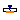 [PrescribedTemperature1D](OpenTEMPEST_Heat.md#opentempestheatprescribedtemperature1d) | Variable temperature boundary condition in Kelvin |
|  [TempSource2DUniform](OpenTEMPEST_Heat.md#opentempestheattempsource2duniform) | Uniformly Distributed Temperature Source for 2D Finite Volume models |
|  [TempSource2DNonUniform](OpenTEMPEST_Heat.md#opentempestheattempsource2dnonuniform) | Non-uniformly Distributed Temperature Source for 2D Finite Volume models |
|  [HeatSource2DNonUniformFV](OpenTEMPEST_Heat.md#opentempestheatheatsource2dnonuniformfv) | Distributed Heat Flow Source for Finite Volume models with non-uniformly distributed flow |

##  [OpenTEMPEST.Heat](OpenTEMPEST_Heat.md#opentempestheat).HTs_HT

Several HTs to one HT adapter

### Parameters

| Name | Description                                   |
|------|-----------------------------------------------|
| N    | Number of HTs (= number of nodes on DHT side) |

### Connectors

| Name          | Description |
|---------------|-------------|
| HT_ports\[N\] |             |
| HT_port       |             |

##  [OpenTEMPEST.Heat](OpenTEMPEST_Heat.md#opentempestheat).HTs_DHT

Several HTs to DHT adapterFV

### Parameters

| Name | Description                                   |
|------|-----------------------------------------------|
| N    | Number of HTs (= number of nodes on DHT side) |

### Connectors

| Name          | Description |
|---------------|-------------|
| HT_ports\[N\] |             |
| DHT_port      |             |

## 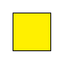 [OpenTEMPEST.Heat](OpenTEMPEST_Heat.md#opentempestheat).DHTVolumes2D

Distributed Heat Terminal

### Parameters

| Name | Description                      |
|------|----------------------------------|
| i    | number of volumes in direction 1 |
| j    | number of volumes in direction 2 |

### Contents

| Name      | Description                      |
|-----------|----------------------------------|
| i         | number of volumes in direction 1 |
| j         | number of volumes in direction 2 |
| T\[i, j\] | Temperature at the volumes \[K\] |
| Q\[i, j\] | Heat flow at the volumes \[W\]   |

## 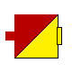 [OpenTEMPEST.Heat](OpenTEMPEST_Heat.md#opentempestheat).HT_DHTVolumes2D

HT to DHT adaptor

### Parameters

| Name | Description                      |
|------|----------------------------------|
| i    | number of volumes in direction 1 |
| j    | number of volumes in direction 2 |

### Connectors

| Name     | Description |
|----------|-------------|
| HT_port  |             |
| DHT_port |             |

## 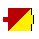 [OpenTEMPEST.Heat](OpenTEMPEST_Heat.md#opentempestheat).HTs_DHTVolumes2D

HT to DHT adaptor

### Parameters

| Name | Description                      |
|------|----------------------------------|
| i    | number of volumes in direction 1 |
| j    | number of volumes in direction 2 |

### Connectors

| Name             | Description |
|------------------|-------------|
| HT_ports\[i, j\] |             |
| DHT_port         |             |

## 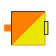 [OpenTEMPEST.Heat](OpenTEMPEST_Heat.md#opentempestheat).DHT_DHTVolumes2D

DHT to DHTVolumes2D adaptor

### Parameters

| Name | Description                                 |
|------|---------------------------------------------|
| i    | number of DHT volumes (direction 1)         |
| j    | number elements in DHT Volume (direction 2) |

### Connectors

| Name          | Description |
|---------------|-------------|
| DHT_port\[i\] |             |
| DHT2D_port    |             |

##  [OpenTEMPEST.Heat](OpenTEMPEST_Heat.md#opentempestheat).DHT_2DHT

### Parameters

| Name | Description                       |
|------|-----------------------------------|
| n    | number of volumens at single port |
| r    | split ratio of the volumes        |

### Connectors

| Name      | Description |
|-----------|-------------|
| DHTSingle |             |
| DHT1      |             |
| DHT2      |             |

##  [OpenTEMPEST.Heat](OpenTEMPEST_Heat.md#opentempestheat).ThermalCollector1D

Collects m heat flows through 1D thermal ports

### Information

This is a model to collect the heat flows from *m* heatports to one single heatport.

### Parameters

| Name | Description                    |
|------|--------------------------------|
| m    | Number of collected heat flows |
| N    | Number of control volumes      |

### Connectors

| Name      | Description |
|-----------|-------------|
| dHT0\[m\] |             |
| dHT1      |             |

##  [OpenTEMPEST.Heat](OpenTEMPEST_Heat.md#opentempestheat).ThermalCollector2D

Collects m heat flows

### Information

This is a model to collect the heat flows from *m* heatports to one single heatport.

### Parameters

| Name | Description                    |
|------|--------------------------------|
| m    | Number of collected heat flows |
| n    | Number of collected heat flows |

### Connectors

| Name           | Description |
|----------------|-------------|
| port_a\[m, n\] |             |
| port_b         |             |

##  [OpenTEMPEST.Heat](OpenTEMPEST_Heat.md#opentempestheat).ForcedConvection

Heat transfer correlation for forced convection

### Information

Extends from ThermoPower.Thermal.BaseClasses.DistributedHeatTransferFV (Base class for distributed heat transfer models - finite volumes).

### Parameters

| Name | Description |
|----|----|
| useAverageTemperature | = true to use average temperature for heat transfer |
| kc | Correction factor for heat transfer \[1\] |
| pipe | = true if flow through a pipe, false if between two parallel plates |
| Set by Flow1D model |  |
| replaceable package Medium | Medium model |
| Nf | Number of nodes on the fluid side |
| Nw | Number of volumes on the wall side |
| Nt | Number of tubes in parallel |
| L | Tube length \[m\] |
| A | Cross-sectional area (single tube) \[m2\] |
| omega | Wet perimeter of heat transfer surface (single tube) \[m\] |
| Dhyd | Hydraulic Diameter (single tube) \[m\] |
| wnom | Nominal mass flow rate (single tube) \[kg/s\] |

### Connectors

| Name | Description |
|------|-------------|
| wall |             |

## 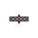 [OpenTEMPEST.Heat](OpenTEMPEST_Heat.md#opentempestheat).RadiativeHeatTransferGenericEnumerate

0D radiative heat transfer with A2\>=A1 & A1 is convex or flat

### Parameters

| Name        | Description                                     |
|-------------|-------------------------------------------------|
| epsilon1    | emissivity of surface 1 \[1\]                   |
| epsilon2    | emissivity of surface 2 \[1\]                   |
| A1          | Area of surface 1, used for special case \[m2\] |
| A2          | Area of surface 2 \[m2\]                        |
| specialCase | Radiation Special Case                          |

### Connectors

| Name  | Description |
|-------|-------------|
| side1 |             |
| side2 |             |

##  [OpenTEMPEST.Heat](OpenTEMPEST_Heat.md#opentempestheat).RadiativeHeatFlowSplitter

Splits a radiative heat flow using only one reference temperature

### Parameters

| Name | Description |
|----|----|
| nCombinedPorts | number of heat ports that are combined, the firsts' temperature is used for radiation |
| epsilon1 | emissivity of surface 1 \[1\] |
| epsilonC | emissivity of the combined surface (side2) \[1\] |
| A1 | Area of surface 1 \[m2\] |
| AC\[nCombinedPorts\] | Area of combined surfaces \[m2\] |
| specialCase | Radiation Special Case |

### Connectors

| Name                    | Description |
|-------------------------|-------------|
| side1                   |             |
| side2\[nCombinedPorts\] |             |

##  [OpenTEMPEST.Heat](OpenTEMPEST_Heat.md#opentempestheat).RadHTFV

Distributed Radiation block model - uses multiple single blocks

### Parameters

| Name        | Description                    |
|-------------|--------------------------------|
| N           | Number of discretisation Units |
| specialCase |                                |
| epsilon1    |                                |
| epsilon2    |                                |
| A1          |                                |
| A2          |                                |

### Connectors

| Name  | Description |
|-------|-------------|
| side1 |             |
| side2 |             |

##  [OpenTEMPEST.Heat](OpenTEMPEST_Heat.md#opentempestheat).ThermalR_HeatC_FV

Modeling thermal resistance between an FV object and an object with lumped T and lumped thermal element storing heat

### Parameters

| Name   | Description                                     |
|--------|-------------------------------------------------|
| N      | Number of nodes of DHT                          |
| R      | Constant thermal resistance \[K/W\]             |
| C      | Heat capacity of element (= cp\*m) \[J/K\]      |
| Tstart | Start value of the temperature of element \[K\] |

### Connectors

| Name | Description |
|------|-------------|
| dHT  |             |
| hT   |             |

## 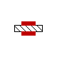 [OpenTEMPEST.Heat](OpenTEMPEST_Heat.md#opentempestheat).conductiveHT

### Information

Extends from ThermoPower.Icons.HeatFlow.

### Parameters

| Name   | Description                     |
|--------|---------------------------------|
| lambda | thermalConductivity \[W/(m.K)\] |
| L      | length \[m\]                    |
| A      | cross sectional area \[m2\]     |

### Connectors

| Name  | Description |
|-------|-------------|
| side1 |             |
| side2 |             |

##  [OpenTEMPEST.Heat](OpenTEMPEST_Heat.md#opentempestheat).conductiveHTVarLambda

### Information

Extends from ThermoPower.Icons.HeatFlow.

### Parameters

| Name     | Description                                |
|----------|--------------------------------------------|
| L        | length \[m\]                               |
| A        | cross sectional area \[m2\]                |
| matOpt   | Options for insulation materials           |
| matLin   | c and lambda = linear(f(T))                |
| matConst | c and lambda = f(TStart) = const.          |
| Fac      | Correction factor for thermal conductivity |

### Connectors

| Name  | Description |
|-------|-------------|
| side1 |             |
| side2 |             |

##  [OpenTEMPEST.Heat](OpenTEMPEST_Heat.md#opentempestheat).ConductiveFV

Conductive thermal resistance without mass

### Parameters

| Name   | Description                     |
|--------|---------------------------------|
| N      | Number of nodes                 |
| lambda | thermalConductivity \[W/(m.K)\] |
| L      | length between heat ports \[m\] |
| A      | cross sectional area \[m2\]     |

### Connectors

| Name  | Description      |
|-------|------------------|
| side1 | Internal surface |
| side2 | External surface |

##  [OpenTEMPEST.Heat](OpenTEMPEST_Heat.md#opentempestheat).InsulationVarArea

### Information

Extends from Modelica.Icons.ObsoleteModel (Icon for classes that are obsolete and will be removed in later versions).

### Parameters

| Name   | Description                       |
|--------|-----------------------------------|
| lambda | thermalConductivity \[W/(m.K)\]   |
| c      | SpecificHeatCapacity \[J/(kg.K)\] |
| rho    | Density \[kg/m3\]                 |
| area1  | area1 \[m2\]                      |
| area2  | area2 \[m2\]                      |
| depth  | depth \[m\]                       |
| TStart | Start temperature \[K\]           |

### Connectors

| Name | Description |
|------|-------------|
| ht1  |             |
| ht2  |             |
| htC  |             |

##  [OpenTEMPEST.Heat](OpenTEMPEST_Heat.md#opentempestheat).HeatTransferNodeUA

### Information

Extends from [OpenTEMPEST.Heat.BaseClasses.HeatTransferNodeBase](OpenTEMPEST_Heat_BaseClasses.md#opentempestheatbaseclassesheattransfernodebase).

### Parameters

| Name  | Description |
|-------|-------------|
| N     |             |
| UAnom |             |
| mfNom | \[kg/s\]    |

### Connectors

| Name     | Description |
|----------|-------------|
| coldWall |             |
| hotWall  |             |
| mf       |             |

## 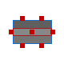 [OpenTEMPEST.Heat](OpenTEMPEST_Heat.md#opentempestheat).Solid0D

### Information

Extends from [OpenTEMPEST.Heat.BaseClasses.Solid0DBase](OpenTEMPEST_Heat_BaseClasses.md#solid0dbase).

### Parameters

| Name | Description |
|----|----|
| replaceable package SolidMat |   |
| Initialisation |  |
| Tstartbar | Uniform initial temperature of the solid \[K\] |
| Dimensions |  |
| lX | Total length of solid \[m\] |
| lY | Total width of solid \[m\] |
| lZ | Total thickness of solid \[m\] |
| Dimensions Extra |  |
| dV | Volume of the solid |
| Ax | Cross sectional area in x-plane \[m2\] |
| Ay | Cross sectional area in y-plane \[m2\] |
| Az | Cross sectional area in z-plane \[m2\] |
| Custom Material Only |  |
| kCustom_trans | \[W/(m.K)\] |
| kCustom_long | \[W/(m.K)\] |
| rhoCustom | \[kg/m3\] |
| cpCustom | \[J/(kg.K)\] |

### Connectors

| Name   | Description |
|--------|-------------|
| hT_xN  |             |
| hT_zN  |             |
| hT_z0  |             |
| hT_y0  |             |
| hT_yN  |             |
| hT_int |             |
| hT_x0  |             |

##  [OpenTEMPEST.Heat](OpenTEMPEST_Heat.md#opentempestheat).Solid1D

### Information

Extends from [OpenTEMPEST.Heat.BaseClasses.Solid1DBase](OpenTEMPEST_Heat_BaseClasses.md#solid1dbase).

### Parameters

| Name | Description |
|----|----|
| replaceable package SolidMat |   |
| N | Number of CVs in the solid |
| Initialisation |  |
| Tstartbar | Uniform initial temperature of the solid \[K\] |
| Dimensions |  |
| lX | Total length of solid \[m\] |
| lY | Total width of solid \[m\] |
| lZ | Total thickness of solid \[m\] |
| Dimensions Extra |  |
| dx | x-Length of a CV \[m\] |
| dV | Volume of a CV \[m3\] |
| Ax | Cross sectional area in x plane \[m2\] |
| Ay | Cross sectional area in y-plane \[m2\] |
| Az | Cross sectional area in z-plane \[m2\] |
| Custom Material Only |  |
| kCustom_trans | \[W/(m.K)\] |
| kCustom_long | \[W/(m.K)\] |
| rhoCustom | \[kg/m3\] |
| cpCustom | \[J/(kg.K)\] |

### Connectors

| Name    | Description |
|---------|-------------|
| hT_x0   |             |
| hT_xN   |             |
| dhT_z1  |             |
| dhT_z0  |             |
| dhT_y0  |             |
| dhT_y1  |             |
| dhT_int |             |

## 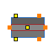 [OpenTEMPEST.Heat](OpenTEMPEST_Heat.md#opentempestheat).Solid2D

### Information

Extends from [OpenTEMPEST.Heat.BaseClasses.Solid2DBase](OpenTEMPEST_Heat_BaseClasses.md#solid2dbase).

### Parameters

| Name | Description |
|----|----|
| replaceable package SolidMat |   |
| nX | Number of CVs in the solid in x-direction |
| nY | Number of CVs in the solid in y-direction |
| Initialisation |  |
| Tstartbar | Uniform initial temperature of the solid \[K\] |
| Dimensions |  |
| lX | Total length of solid in x-direction \[m\] |
| lY | Total length of solid in y-direction \[m\] |
| lZ | Total thickness of solid in z-direction \[m\] |
| Dimensions Extra |  |
| dx | x-Length of a CV \[m\] |
| dy | y-Length of a CV \[m\] |
| dV | Volume of a CV \[m3\] |
| Ax | Cross sectional area in x-plane \[m2\] |
| Ay | Cross sectional area in y-plane \[m2\] |
| Az | Cross sectional area in z-plane \[m2\] |
| Custom Material Only |  |
| kCustom_trans | Custom thermal conductivity across layers (z-direction) \[W/(m.K)\] |
| kCustom_long | Custom thermal conductivity in-plane (x/y); defaults to kCustom_trans \[W/(m.K)\] |
| rhoCustom | Custom density \[kg/m3\] |
| cpCustom | Custom specific heat capacity \[J/(kg.K)\] |

### Connectors

| Name     | Description |
|----------|-------------|
| dhT_x0   |             |
| dhT_xN   |             |
| dhT2_z1  |             |
| dhT2_z0  |             |
| dhT_y0   |             |
| dhT_yN   |             |
| dhT2_int |             |

## 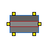 [OpenTEMPEST.Heat](OpenTEMPEST_Heat.md#opentempestheat).Solid3D

### Information

Extends from [OpenTEMPEST.Heat.BaseClasses.Solid3DBase](OpenTEMPEST_Heat_BaseClasses.md#solid3dbase).

### Parameters

| Name | Description |
|----|----|
| replaceable package SolidMat |   |
| nX | Number of CVs in the solid in x-direction |
| nY | Number of CVs in the solid in y-direction |
| nZ | Number of CVs in the solid in z-direction |
| Initialisation |  |
| Tstartbar | Uniform initial temperature of the solid \[K\] |
| Dimensions |  |
| lX | Total length of solid in x-direction \[m\] |
| lY | Total width of solid in y-direction \[m\] |
| lZ | Total thickness of solid in z-direction \[m\] |
| Dimensions Extra |  |
| dx | x-length of a CV \[m\] |
| dy | y-length of a CV \[m\] |
| dz | z-length of a CV \[m\] |
| dV | Volume of a CV \[m3\] |
| Ax | Cross sectional area in x-plane \[m2\] |
| Ay | Cross sectional area in y-plane \[m2\] |
| Az | Cross sectional area in z-plane \[m2\] |
| Custom Material Only |  |
| kCustom_trans | Custom thermal conductivity across layers (z-direction) \[W/(m.K)\] |
| kCustom_long | Custom thermal conductivity in-plane (x/y); defaults to kCustom_trans \[W/(m.K)\] |
| rhoCustom | Custom density \[kg/m3\] |
| cpCustom | Custom specific heat capacity \[J/(kg.K)\] |

### Connectors

| Name    | Description |
|---------|-------------|
| dhT2_x0 |             |
| dhT2_xN |             |
| dhT2_zN |             |
| dhT2_z0 |             |
| dhT2_y0 |             |
| dhT2_yN |             |

## 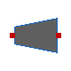 [OpenTEMPEST.Heat](OpenTEMPEST_Heat.md#opentempestheat).Solid0DvarArea

solid 1D volume with area variation along the x-axis (truncated pyramid with base area in y-z-plane)

### Information

truncated pyramid volume with heat transfer along x-direction. Pyramid base area is y0\*z0.

### Parameters

| Name                         | Description                 |
|------------------------------|-----------------------------|
| replaceable package SolidMat |                             |
| Initialisation               |                             |
| TstartIn                     | \[K\]                       |
| TstartOut                    | \[K\]                       |
| Tstart                       | \[K\]                       |
| Dimensions                   |                             |
| lX                           | Total length of solid \[m\] |
| A0                           | CS area at x/L=0 \[m2\]     |
| A1                           | CS area at x/L=1 \[m2\]     |
| Custom Material Only         |                             |
| kCustom                      | \[W/(m.K)\]                 |
| rhoCustom                    | \[kg/m3\]                   |
| cpCustom                     | \[J/(kg.K)\]                |

### Connectors

| Name                         | Description |
|------------------------------|-------------|
| replaceable package SolidMat |             |
| hT_x0                        |             |
| hT_x1                        |             |

## 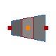 [OpenTEMPEST.Heat](OpenTEMPEST_Heat.md#opentempestheat).Solid1DvarArea

solid 1D volume with area variation along the x-axis (truncated pyramid with base area in y-z-plane)

### Information

truncated pyramid volume with heat transfer along x-direction. Pyramid base area is y0\*z0.

### Parameters

| Name                         | Description                 |
|------------------------------|-----------------------------|
| replaceable package SolidMat |                             |
| N                            | Number of CVs in the solid  |
| Initialisation               |                             |
| TstartIn                     | \[K\]                       |
| TstartOut                    | \[K\]                       |
| Tstart\[N\]                  | \[K\]                       |
| Dimensions                   |                             |
| lX                           | Total length of solid \[m\] |
| A0                           | CS area at x/L=0 \[m2\]     |
| A1                           | CS area at x/L=1 \[m2\]     |
| Custom Material Only         |                             |
| kCustom_trans                | \[W/(m.K)\]                 |
| kCustom_long                 | \[W/(m.K)\]                 |
| rhoCustom                    | \[kg/m3\]                   |
| cpCustom                     | \[J/(kg.K)\]                |

### Connectors

| Name                         | Description |
|------------------------------|-------------|
| replaceable package SolidMat |             |
| hT_x0                        |             |
| hT_xN                        |             |
| dhT_int                      |             |

## 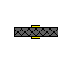 [OpenTEMPEST.Heat](OpenTEMPEST_Heat.md#opentempestheat).RadHT2DFV

Distributed Radiation block model - uses multiple single blocks

### Parameters

| Name        | Description                      |
|-------------|----------------------------------|
| nX          | Number of volumes in x-direction |
| nY          | Number of volumes in y-direction |
| specialCase |                                  |
| epsilon1    |                                  |
| epsilon2    |                                  |
| A1          |                                  |
| A2          |                                  |

### Connectors

| Name  | Description |
|-------|-------------|
| side1 |             |
| side2 |             |

## 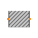 [OpenTEMPEST.Heat](OpenTEMPEST_Heat.md#opentempestheat).ThermalConductor1D

Lumped thermal element transporting heat without storing it with 1D thermal ports

### Information

This is a model for transport of heat without storing it; see also: ThermalResistor. It may be used for complicated geometries where the thermal conductance G (= inverse of thermal resistance) is determined by measurements and is assumed to be constant over the range of operations. If the component consists mainly of one type of material and a regular geometry, it may be calculated, e.g., with one of the following equations:

- Conductance for a **box** geometry under the assumption that heat flows along the box length:

          G = k*A/L
          k: Thermal conductivity (material constant)
          A: Area of box
          L: Length of box
          

- Conductance for a **cylindrical** geometry under the assumption that heat flows from the inside to the outside radius of the cylinder:

          G = 2*pi*k*L/log(r_out/r_in)
          pi   : Modelica.Constants.pi
          k    : Thermal conductivity (material constant)
          L    : Length of cylinder
          log  : Modelica.Math.log;
          r_out: Outer radius of cylinder
          r_in : Inner radius of cylinder
          

&nbsp;

        Typical values for k at 20 degC in W/(m.K):
          aluminium   220
          concrete      1
          copper      384
          iron         74
          silver      407
          steel        45 .. 15 (V2A)
          wood         0.1 ... 0.2

Extends from [BaseClasses.Element1D](OpenTEMPEST_Heat_BaseClasses.md#opentempestheatbaseclasseselement1d) (Partial heat transfer element with two 1D thermal ports that does not store energy).

### Parameters

| Name | Description                                      |
|------|--------------------------------------------------|
| N    | Number of control volumes                        |
| G    | Constant thermal conductance of material \[W/K\] |

### Connectors

| Name | Description |
|------|-------------|
| dHT0 |             |
| dHT1 |             |

##  [OpenTEMPEST.Heat](OpenTEMPEST_Heat.md#opentempestheat).PrescribedTemperature1D

Variable temperature boundary condition in Kelvin

### Information

This model represents a variable temperature boundary condition. The temperature in \[K\] is given as input signal **T** to the model. The effect is that an instance of this model acts as an infinite reservoir able to absorb or generate as much energy as required to keep the temperature at the specified value.

Extends from ThermoPower.Icons.HeatFlow.

### Parameters

| Name | Description               |
|------|---------------------------|
| N    | Number of control volumes |

### Connectors

| Name   | Description |
|--------|-------------|
| port   |             |
| T\[N\] | \[K\]       |

## 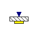 [OpenTEMPEST.Heat](OpenTEMPEST_Heat.md#opentempestheat).TempSource2DUniform

Uniformly Distributed Temperature Source for 2D Finite Volume models

### Information

Extends from [OpenTEMPEST.Heat.BaseClasses.TempSource2DBase](OpenTEMPEST_Heat_BaseClasses.md#opentempestheatbaseclassestempsource2dbase) (Base Model Distributed Temperature Source for 2D Finite Volume models).

### Parameters

| Name | Description                   |
|------|-------------------------------|
| nX   | Number of volumes x-direction |
| nY   | Number of volumes y-direction |

### Connectors

| Name        | Description             |
|-------------|-------------------------|
| wall        |                         |
| temperature | Temperature \[K\] \[K\] |

##  [OpenTEMPEST.Heat](OpenTEMPEST_Heat.md#opentempestheat).TempSource2DNonUniform

Non-uniformly Distributed Temperature Source for 2D Finite Volume models

### Information

Extends from [OpenTEMPEST.Heat.BaseClasses.TempSource2DBase](OpenTEMPEST_Heat_BaseClasses.md#opentempestheatbaseclassestempsource2dbase) (Base Model Distributed Temperature Source for 2D Finite Volume models).

### Parameters

| Name | Description                   |
|------|-------------------------------|
| nX   | Number of volumes x-direction |
| nY   | Number of volumes y-direction |

### Connectors

| Name                  | Description |
|-----------------------|-------------|
| wall                  |             |
| temperature\[nX, nY\] |             |

##  [OpenTEMPEST.Heat](OpenTEMPEST_Heat.md#opentempestheat).HeatSource2DNonUniformFV

Distributed Heat Flow Source for Finite Volume models with non-uniformly distributed flow

### Information

Extends from ThermoPower.Icons.HeatFlow.

### Parameters

| Name | Description                   |
|------|-------------------------------|
| nX   | Number of volumes x-direction |
| nY   | Number of volumes y-direction |

### Connectors

| Name            | Description |
|-----------------|-------------|
| wall            |             |
| power\[nX, nY\] |             |

[Automatically generated](http://www.3ds.com/) Sun Sep 20 19:09:49 2026.
