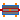
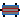
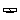
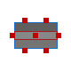
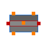
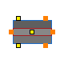
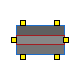
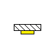

## [OpenTEMPEST.Heat](OpenTEMPEST_Heat.md#opentempestheat).BaseClasses

### Package Content

| Name | Description |
|----|----|
|  [HeatTransferNodeBase](OpenTEMPEST_Heat_BaseClasses.md#opentempestheatbaseclassesheattransfernodebase) |   |
|  [Solid0DBase](OpenTEMPEST_Heat_BaseClasses.md#solid0dbase) |   |
|  [Solid1DBase](OpenTEMPEST_Heat_BaseClasses.md#solid1dbase) |   |
|  [Solid2DBase](OpenTEMPEST_Heat_BaseClasses.md#solid2dbase) |   |
|  [Solid3DBase](OpenTEMPEST_Heat_BaseClasses.md#solid3dbase) |   |
|  [Element1D](OpenTEMPEST_Heat_BaseClasses.md#opentempestheatbaseclasseselement1d) | Partial heat transfer element with two 1D thermal ports that does not store energy |
|  [TempSource2DBase](OpenTEMPEST_Heat_BaseClasses.md#opentempestheatbaseclassestempsource2dbase) | Base Model Distributed Temperature Source for 2D Finite Volume models |

##  [OpenTEMPEST.Heat.BaseClasses](OpenTEMPEST_Heat_BaseClasses.md#opentempestheatbaseclasses).HeatTransferNodeBase

### Parameters

| Name | Description |
|------|-------------|
| N    |             |

### Connectors

| Name     | Description |
|----------|-------------|
| coldWall |             |
| hotWall  |             |

##  [OpenTEMPEST.Heat.BaseClasses](OpenTEMPEST_Heat_BaseClasses.md#opentempestheatbaseclasses).Solid0DBase

### Information

## Solid0DBase

The model represents a zero-dimensional (lumped) solid with a single control volume. It computes the transient temperature of the solid based on conduction through all six faces (x0, xN, y0, yN, z0, zN), as well as a user-defined external heat flux. The model supports anisotropic and custom material properties.

### Parameters

| Name | Description |
|----|----|
| replaceable package SolidMat |   |
| Initialisation |  |
| Tstartbar | Uniform initial temperature of the solid \[K\] |
| Dimensions |  |
| lX | Total length of solid \[m\] |
| lY | Total width of solid \[m\] |
| lZ | Total thickness of solid \[m\] |
| Dimensions Extra |  |
| dV | Volume of the solid |
| Ax | Cross sectional area in x-plane \[m2\] |
| Ay | Cross sectional area in y-plane \[m2\] |
| Az | Cross sectional area in z-plane \[m2\] |
| Custom Material Only |  |
| kCustom_trans | \[W/(m.K)\] |
| kCustom_long | \[W/(m.K)\] |
| rhoCustom | \[kg/m3\] |
| cpCustom | \[J/(kg.K)\] |

### Connectors

| Name                         | Description |
|------------------------------|-------------|
| replaceable package SolidMat |             |
| hT_xN                        |             |
| hT_zN                        |             |
| hT_z0                        |             |
| hT_y0                        |             |
| hT_yN                        |             |
| hT_int                       |             |
| hT_x0                        |             |

##  [OpenTEMPEST.Heat.BaseClasses](OpenTEMPEST_Heat_BaseClasses.md#opentempestheatbaseclasses).Solid1DBase

### Information

## Solid1DBase

The model represents a one-dimensional solid discretized into control volumes (CVs) in the x-direction. It computes the transient temperature distribution within the solid based on conduction in the x-direction, as well as heat exchange in the y- and z-directions through thermal ports and user-defined external heat fluxes. The model supports anisotropic and custom material properties.

### Parameters

| Name | Description |
|----|----|
| replaceable package SolidMat |   |
| N | Number of CVs in the solid |
| Initialisation |  |
| Tstartbar | Uniform initial temperature of the solid \[K\] |
| Dimensions |  |
| lX | Total length of solid \[m\] |
| lY | Total width of solid \[m\] |
| lZ | Total thickness of solid \[m\] |
| Dimensions Extra |  |
| dx | x-Length of a CV \[m\] |
| dV | Volume of a CV \[m3\] |
| Ax | Cross sectional area in x plane \[m2\] |
| Ay | Cross sectional area in y-plane \[m2\] |
| Az | Cross sectional area in z-plane \[m2\] |
| Custom Material Only |  |
| kCustom_trans | \[W/(m.K)\] |
| kCustom_long | \[W/(m.K)\] |
| rhoCustom | \[kg/m3\] |
| cpCustom | \[J/(kg.K)\] |

### Connectors

| Name                         | Description |
|------------------------------|-------------|
| replaceable package SolidMat |             |
| hT_x0                        |             |
| hT_xN                        |             |
| dhT_z1                       |             |
| dhT_z0                       |             |
| dhT_y0                       |             |
| dhT_y1                       |             |
| dhT_int                      |             |

##  [OpenTEMPEST.Heat.BaseClasses](OpenTEMPEST_Heat_BaseClasses.md#opentempestheatbaseclasses).Solid2DBase

### Information

## Solid2DBase

The model represents a two-dimensional solid discretized into control volumes (CVs) in the x- and y-directions. It computes the transient temperature distribution within the solid based on conduction in x-, y-, and z-directions, as well as user-defined external heat fluxes. The model supports anisotropic and custom material properties.

### Parameters

| Name | Description |
|----|----|
| replaceable package SolidMat |   |
| nX | Number of CVs in the solid in x-direction |
| nY | Number of CVs in the solid in y-direction |
| Initialisation |  |
| Tstartbar | Uniform initial temperature of the solid \[K\] |
| Dimensions |  |
| lX | Total length of solid in x-direction \[m\] |
| lY | Total length of solid in y-direction \[m\] |
| lZ | Total thickness of solid in z-direction \[m\] |
| Dimensions Extra |  |
| dx | x-Length of a CV \[m\] |
| dy | y-Length of a CV \[m\] |
| dV | Volume of a CV \[m3\] |
| Ax | Cross sectional area in x-plane \[m2\] |
| Ay | Cross sectional area in y-plane \[m2\] |
| Az | Cross sectional area in z-plane \[m2\] |
| Custom Material Only |  |
| kCustom_trans | Custom thermal conductivity across layers (z-direction) \[W/(m.K)\] |
| kCustom_long | Custom thermal conductivity in-plane (x/y); defaults to kCustom_trans \[W/(m.K)\] |
| rhoCustom | Custom density \[kg/m3\] |
| cpCustom | Custom specific heat capacity \[J/(kg.K)\] |

### Connectors

| Name                         | Description |
|------------------------------|-------------|
| replaceable package SolidMat |             |
| dhT_x0                       |             |
| dhT_xN                       |             |
| dhT2_z1                      |             |
| dhT2_z0                      |             |
| dhT_y0                       |             |
| dhT_yN                       |             |
| dhT2_int                     |             |

##  [OpenTEMPEST.Heat.BaseClasses](OpenTEMPEST_Heat_BaseClasses.md#opentempestheatbaseclasses).Solid3DBase

### Information

## Solid3DBase

The model represents a three-dimensional solid discretized into control volumes (CVs) in the x-, y- and z-directions. It computes the transient temperature distribution within the solid based on conduction in x-, y-, and z-directions, as well as user-defined external heat fluxes. The model supports anisotropic and custom material properties.

### Parameters

| Name | Description |
|----|----|
| replaceable package SolidMat |   |
| nX | Number of CVs in the solid in x-direction |
| nY | Number of CVs in the solid in y-direction |
| nZ | Number of CVs in the solid in z-direction |
| Initialisation |  |
| Tstartbar | Uniform initial temperature of the solid \[K\] |
| Dimensions |  |
| lX | Total length of solid in x-direction \[m\] |
| lY | Total width of solid in y-direction \[m\] |
| lZ | Total thickness of solid in z-direction \[m\] |
| Dimensions Extra |  |
| dx | x-length of a CV \[m\] |
| dy | y-length of a CV \[m\] |
| dz | z-length of a CV \[m\] |
| dV | Volume of a CV \[m3\] |
| Ax | Cross sectional area in x-plane \[m2\] |
| Ay | Cross sectional area in y-plane \[m2\] |
| Az | Cross sectional area in z-plane \[m2\] |
| Custom Material Only |  |
| kCustom_trans | Custom thermal conductivity across layers (z-direction) \[W/(m.K)\] |
| kCustom_long | Custom thermal conductivity in-plane (x/y); defaults to kCustom_trans \[W/(m.K)\] |
| rhoCustom | Custom density \[kg/m3\] |
| cpCustom | Custom specific heat capacity \[J/(kg.K)\] |

### Connectors

| Name                         | Description |
|------------------------------|-------------|
| replaceable package SolidMat |             |
| dhT2_x0                      |             |
| dhT2_xN                      |             |
| dhT2_zN                      |             |
| dhT2_z0                      |             |
| dhT2_y0                      |             |
| dhT2_yN                      |             |

##  [OpenTEMPEST.Heat.BaseClasses](OpenTEMPEST_Heat_BaseClasses.md#opentempestheatbaseclasses).Element1D

Partial heat transfer element with two 1D thermal ports that does not store energy

### Information

This partial model contains the basic connectors and variables to allow heat transfer models to be created that **do not store energy**, This model defines and includes equations for the temperature drop across the element, **dT**, and the heat flow rate through the element from dHT0 to dHT1, **Q**.

By extending this model, it is possible to write simple constitutive equations for many types of heat transfer components.

### Parameters

| Name | Description               |
|------|---------------------------|
| N    | Number of control volumes |

### Connectors

| Name | Description |
|------|-------------|
| dHT0 |             |
| dHT1 |             |

##  [OpenTEMPEST.Heat.BaseClasses](OpenTEMPEST_Heat_BaseClasses.md#opentempestheatbaseclasses).TempSource2DBase

Base Model Distributed Temperature Source for 2D Finite Volume models

### Information

Extends from ThermoPower.Icons.HeatFlow.

### Parameters

| Name | Description                   |
|------|-------------------------------|
| nX   | Number of volumes x-direction |
| nY   | Number of volumes y-direction |

### Connectors

| Name | Description |
|------|-------------|
| wall |             |

[Automatically generated](http://www.3ds.com/) Sun Sep 20 19:09:49 2026.
