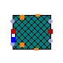

## [OpenTEMPEST.SOC.Cell](OpenTEMPEST_SOC_Cell.md#opentempestsoccell).Cell1D

### Package Content

| Name                                                                                                                                                                                                      | Description |
| -----------------------------------------------------------------------------------------------------------------------------------------------------------------------------------------------------------| -------------|
|  [Components](OpenTEMPEST_SOC_Cell_Cell1D_Components.md#opentempestsoccellcell1dcomponents)                                 |             |
|  [Cell](OpenTEMPEST_SOC_Cell_Cell1D.md#cell)                                                                                    |             |
|  [SimplifiedCellBlock](OpenTEMPEST_SOC_Cell_Cell1D.md#opentempestsoccellcell1dsimplifiedcellblock) |             |

##  [OpenTEMPEST.SOC.Cell.Cell1D](OpenTEMPEST_SOC_Cell_Cell1D.md#opentempestsoccellcell1d).Cell

### Information

## Cell

The model represents a one-dimensional discretized into N control volumes along the channel direction.

The cell consists of a discretized PEN with electrochemistry, axial fuel and air channels, and metallic interconnects. Heat transfer between PEN, channels, and interconnects is modeled via convective and radiative elements. Gas manifolds supply the reactants, while Darcy-based pressure drop and electrochemical reactions are computed along the channels. Geometrical dimensions, material properties, discretization, and transport parameters are fully parameterized.

### Parameters

| Name | Description |
|----|----|
| N | number of CVs in each layer |
| lX | \[m\] |
| lY | \[m\] |
| replaceable function fluxInterp |   |
| replaceable model Electrochem |   |
| Fuel Channel |  |
| replaceable package FCMedium |   |
| lXfc | \[m\] |
| lYfc | \[m\] |
| lZfc | \[m\] |
| porFC |   |
| Nu_PENfc | Nusselt number fuel channel on PEN side |
| Nu_ICfc | Nusselt Number fuel channel on IC side |
| kFoam | \[W/(m.K)\] |
| cpFoam | \[J/(kg.K)\] |
| rhoFoam | \[kg/m3\] |
| HyR_Fuel | Hydraulic resistance of fuel channel of each single cell in stack \[Pa/(kg/s)\] |
| Air Channel |  |
| replaceable package ACMedium |   |
| lXac | \[m\] |
| lYac | \[m\] |
| lZac | \[m\] |
| porAC |   |
| pDropAC |   |
| Nu_PENac | Nusselt number air channel on PEN side |
| Nu_ICac | Nusselt Number air channel on IC side |
| HyR_Air | Hydraulic resistance of air channel of each single cell in stack \[Pa/(kg/s)\] |
| Initialization |  |
| TStart | \[K\] |
| TStart_pen | \[K\] |
| TStart_FCin | \[K\] |
| TStart_FCout | \[K\] |
| TStart_ACin | \[K\] |
| TStart_ACout | \[K\] |
| TStart_IC | \[K\] |
| pStartAC | \[Pa\] |
| pStartInFC | \[Pa\] |
| pStartOutFC | \[Pa\] |
| Jstart | \[A/m2\] |
| xStartAC\[ACMedium.nXi\] | \[1\] |
| xStartFC\[FCMedium.nX\] | \[1\] |
| dpNomFC | nominal pressure loss for initialization \[Pa\] |
| PEN |  |
| lXpen | \[m\] |
| lYpen | \[m\] |
| lZpen | \[m\] |
| kPen | \[W/(m.K)\] |
| rhoPen | \[kg/m3\] |
| cpPen | \[J/(kg.K)\] |
| epsilon_pen | emissivity of Anode-Electrolyte-Cathode unit \[1\] |
| Interconnect |  |
| epsilon_ic | emissivity of surface of IC \[1\] |
| lZIC | half of IC height \[m\] |
| rhoIC | Density of IC unit \[kg/m3\] |
| cpIC | specific heat capcity of IC \[J/(kg.K)\] |
| LambdaIC | thermal conductivity of IC \[W/(m.K)\] |

### Connectors

| Name                            | Description |
|---------------------------------|-------------|
| replaceable function fluxInterp |             |
| replaceable model Electrochem   |             |
| fuelFlangeIn                    |             |
| fuelFlangeOut                   |             |
| airFlangeIn                     |             |
| airFlangeOut                    |             |
| pin_p                           |             |
| pin_n                           |             |
| dHT_z1                          |             |
| dHT_z0                          |             |
| dHT_y0                          |             |
| dHT_y1                          |             |
| hT_x0                           |             |
| hT_xN                           |             |
| Fuel Channel                    |             |
| replaceable package FCMedium    |             |
| Air Channel                     |             |
| replaceable package ACMedium    |             |

##  [OpenTEMPEST.SOC.Cell.Cell1D](OpenTEMPEST_SOC_Cell_Cell1D.md#opentempestsoccellcell1d).SimplifiedCellBlock

### Information

## Simplified 1D Cell Block

This model represents a simplified 1D block of cells and associated thermal volumes. It discretizes the block of cells into N control volumes along the x-direction and optionally represents multiple cells stacked in the z-direction.

### Parameters

| Name | Description |
|----|----|
| N | number of CVs in each layer |
| nCellVertMult | number of cells this object is representing in z direction |
| TStart | Starting temperature \[K\] |
| lX | Length of active part of cell \[m\] |
| lY | Width of active part of cell \[m\] |
| lZ | Thickness of IC over the active part of cell \[m\] |
| rho_custom | Density of custom material \[kg/m3\] |
| cp_custom | Specific Heat capacity of custom material \[J/(kg.K)\] |
| k_custom | Thermal condusctivity of custom material \[W/(m.K)\] |
| Interconnect |  |
| k_solidCustomLong | Thermal Conductivity of solid along x-direction \[W/(m.K)\] |
| k_solidCustomTrans | Thermal Conductivity of solid along z-direction \[W/(m.K)\] |
| cp_solidCustom | Specific heat capacity of solid parallel to windows \[J/(kg.K)\] |
| rho_solidCustom | Density of solid parallel to windows \[kg/m3\] |

### Connectors

| Name                         | Description |
|------------------------------|-------------|
| hTactive_x0\[nCellVertMult\] |             |
| hTactive_x1\[nCellVertMult\] |             |
| dHTactive_y0                 |             |
| dHTactive_y1                 |             |
| dHTactive_z0                 |             |
| dHTactive_z1                 |             |
| simpFlowInfoPortIn\[N\]      |             |
| reactionHeatInfoPort\[N\]    |             |
| simpFlowInfoPortOut\[N\]     |             |

[Automatically generated](http://www.3ds.com/) Sun Sep 20 19:09:48 2026.
