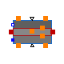

## [OpenTEMPEST.SOC.Cell.Cell1D](OpenTEMPEST_SOC_Cell_Cell1D.md#opentempestsoccellcell1d).Components

### Package Content

| Name                                                                                                                                                                                  | Description |
| ---------------------------------------------------------------------------------------------------------------------------------------------------------------------------------------| -------------|
|  [AirChannel](OpenTEMPEST_SOC_Cell_Cell1D_Components.md#airchannel)          |             |
|  [FuelChannel](OpenTEMPEST_SOC_Cell_Cell1D_Components.md#fuelchannel)       |             |
|  [PEN1D](OpenTEMPEST_SOC_Cell_Cell1D_Components.md#pen1d)                         |             |
|  [Channel1DBase](OpenTEMPEST_SOC_Cell_Cell1D_Components.md#channel1dbase) |             |

##  [OpenTEMPEST.SOC.Cell.Cell1D.Components](OpenTEMPEST_SOC_Cell_Cell1D_Components.md#opentempestsoccellcell1dcomponents).AirChannel

### Information

## AirChannel

One-dimensional finite-volume air channel model extending `Channel1DBase`. The model describes coupled mass, energy, and momentum balances in the channel including oxygen electrochemical reaction and axial pressure drop.

### Included Phenomena

- Oxygen electrochemical reaction via `PEN_in`
- Electrochemical heat source term
- Darcy-based axial pressure drop
- Convective heat exchange with PEN and interconnect

Extends from [OpenTEMPEST.SOC.Cell.Cell1D.Components.Channel1DBase](OpenTEMPEST_SOC_Cell_Cell1D_Components.md#channel1dbase).

### Parameters

| Name                            | Description                                                      |
| ---------------------------------| ------------------------------------------------------------------|
| replaceable package Medium      |                                                                  |
| N                               |                                                                  |
| replaceable function fluxInterp |                                                                  |
| Nu_PEN                          | Nusselt number on PEN side                                       |
| Nu_IC                           | Nusselt Number on IC side                                        |
| pDrop                           | pressure drop as a factor of inlet pressure (between 0 and 0.99) |
| Initialisation                  |                                                                  |
| TStartIn                        | \[K\]                                                            |
| TStartOut                       | \[K\]                                                            |
| TStart\[N\]                     | \[K\]                                                            |
| pStartIn                        | \[Pa\]                                                           |
| pStartOut                       | \[Pa\]                                                           |
| pStart\[N + 1\]                 | \[Pa\]                                                           |
| xStart\[nSpecies\]              | \[1\]                                                            |
| Dimensions                      |                                                                  |
| lY                              | width of channel \[m\]                                           |
| lZ                              | Height of channel \[m\]                                          |
| lX                              | Length of channel /m \[m\]                                       |
| por                             | channel porosity                                                 |

### Connectors

| Name                       | Description                |
|----------------------------|----------------------------|
| replaceable package Medium |                            |
| infl                       |                            |
| outfl                      |                            |
| Q_IC                       | HT Between Channel and IC  |
| Q_PEN                      | HT Between Channel and PEN |
| PEN_in\[N\]                |                            |

##  [OpenTEMPEST.SOC.Cell.Cell1D.Components](OpenTEMPEST_SOC_Cell_Cell1D_Components.md#opentempestsoccellcell1dcomponents).FuelChannel

### Information

## FuelChannel

One-dimensional finite-volume fuel channel model extending `Channel1DBase`. The model describes coupled mass, energy, and momentum balances in a porous nickel foam channel including heterogeneous reforming reactions and electrochemical source terms.

### Modeling Assumptions

- 1D discretization in flow direction
- Thermal equilibrium between gas and nickel foam solid phase
- Effective axial heat conduction in the solid matrix
- Darcy-based pressure drop formulation

### Included Phenomena

Methane Steam Reforming (MSR)

Water-Gas Shift (WGS)

Hydrogen electrochemical reaction

Carbon dioxide electrochemical reaction

Axial solid conduction through nickel foam

Distributed pressure losses

Extends from [OpenTEMPEST.SOC.Cell.Cell1D.Components.Channel1DBase](OpenTEMPEST_SOC_Cell_Cell1D_Components.md#channel1dbase).

### Parameters

| Name | Description |
|----|----|
| replaceable package Medium |   |
| N |   |
| replaceable function fluxInterp |   |
| Nu_PEN | Nusselt number on PEN side |
| Nu_IC | Nusselt Number on IC side |
| k_eff_Ni | Nickel foam effective thermal conductivity \[W/(m.K)\] |
| cp_Ni | Nickel heat capacity \[J/(kg.K)\] |
| rho_Ni | Nickel density \[kg/m3\] |
| dpNom | nominal pressure loss for initialization \[Pa\] |
| Initialisation |  |
| TStartIn | \[K\] |
| TStartOut | \[K\] |
| TStart\[N\] | \[K\] |
| pStartIn | \[Pa\] |
| pStartOut | \[Pa\] |
| pStart\[N + 1\] | \[Pa\] |
| xStart\[nSpecies\] | \[1\] |
| Dimensions |  |
| lY | width of channel \[m\] |
| lZ | Height of channel \[m\] |
| lX | Length of channel /m \[m\] |
| por | channel porosity |

### Connectors

| Name                       | Description                     |
|----------------------------|---------------------------------|
| replaceable package Medium |                                 |
| infl                       |                                 |
| outfl                      |                                 |
| Q_IC                       | HT Between Channel and IC       |
| Q_PEN                      | HT Between Channel and PEN      |
| PEN_in\[N\]                |                                 |
| hTNi_x0                    | conductive HT through Ni at x=0 |
| hTNi_xN                    | conductive HT through Ni at x=L |

##  [OpenTEMPEST.SOC.Cell.Cell1D.Components](OpenTEMPEST_SOC_Cell_Cell1D_Components.md#opentempestsoccellcell1dcomponents).PEN1D

### Information

## PEN1D

The model represents a one-dimensional discretized Positive Electrode–Electrolyte–Negative Electrode (PEN) structure. The model couples:

- Electrochemical reactions in each control volume
- Electrical current distribution
- Species and mass transport through electrochemical interfaces

Extends from [Heat.BaseClasses.Solid1DBase](OpenTEMPEST_Heat_BaseClasses.md#solid1dbase).

### Parameters

| Name | Description |
|----|----|
| replaceable package SolidMat |   |
| N | Number of CVs in the solid |
| Jstart | \[A/m2\] |
| replaceable model Electrochem |   |
| Initialisation |  |
| Tstartbar | Uniform initial temperature of the solid \[K\] |
| Dimensions |  |
| lX | Total length of solid \[m\] |
| lY | Total width of solid \[m\] |
| lZ | Total thickness of solid \[m\] |
| Dimensions Extra |  |
| dx | x-Length of a CV \[m\] |
| dV | Volume of a CV \[m3\] |
| Ax | Cross sectional area in x plane \[m2\] |
| Ay | Cross sectional area in y-plane \[m2\] |
| Az | Cross sectional area in z-plane \[m2\] |
| Custom Material Only |  |
| kCustom_trans | \[W/(m.K)\] |
| kCustom_long | \[W/(m.K)\] |
| rhoCustom | \[kg/m3\] |
| cpCustom | \[J/(kg.K)\] |

### Connectors

| Name                          | Description |
|-------------------------------|-------------|
| hT_x0                         |             |
| hT_xN                         |             |
| dhT_z1                        |             |
| dhT_z0                        |             |
| dhT_y0                        |             |
| dhT_y1                        |             |
| dhT_int                       |             |
| replaceable model Electrochem |             |
| PEN_ina\[N\]                  |             |
| PEN_in\[N\]                   |             |
| pin_n                         |             |
| pin_p                         |             |
| Qrad_FI                       |             |
| Qrad_AI                       |             |

##  [OpenTEMPEST.SOC.Cell.Cell1D.Components](OpenTEMPEST_SOC_Cell_Cell1D_Components.md#opentempestsoccellcell1dcomponents).Channel1DBase

### Information

## Channel1DBase

Partial finite-volume base model for one-dimensional gas flow channels. The channel is discretized into N control volumes (CVs) along its length.

### Governing Equations

- Total mass conservation (finite-volume form)
- Species mass conservation for each gas component
- Gas-phase energy conservation (internal energy formulation)
- Convective fluxes computed via replaceable interpolation scheme
- Heat exchange with PEN and interconnect via distributed heat ports

### Parameters

| Name                            | Description                |
|---------------------------------|----------------------------|
| replaceable package Medium      |                            |
| N                               |                            |
| replaceable function fluxInterp |                            |
| Nu_PEN                          | Nusselt number on PEN side |
| Nu_IC                           | Nusselt Number on IC side  |
| Initialisation                  |                            |
| TStartIn                        | \[K\]                      |
| TStartOut                       | \[K\]                      |
| TStart\[N\]                     | \[K\]                      |
| pStartIn                        | \[Pa\]                     |
| pStartOut                       | \[Pa\]                     |
| pStart\[N + 1\]                 | \[Pa\]                     |
| xStart\[nSpecies\]              | \[1\]                      |
| Dimensions                      |                            |
| lY                              | width of channel \[m\]     |
| lZ                              | Height of channel \[m\]    |
| lX                              | Length of channel /m \[m\] |
| por                             | channel porosity           |

### Connectors

| Name                            | Description                |
|---------------------------------|----------------------------|
| replaceable package Medium      |                            |
| replaceable function fluxInterp |                            |
| infl                            |                            |
| outfl                           |                            |
| Q_IC                            | HT Between Channel and IC  |
| Q_PEN                           | HT Between Channel and PEN |
| PEN_in\[N\]                     |                            |

[Automatically generated](http://www.3ds.com/) Sun Sep 20 19:09:48 2026.
