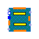
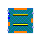
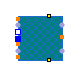

## [OpenTEMPEST.SOC.Cell](OpenTEMPEST_SOC_Cell.md#opentempestsoccell).CrossFlow

### Package Content

| Name | Description |
|----|----|
|  [Components](OpenTEMPEST_SOC_Cell_CrossFlow_Components.md#opentempestsoccellcrossflowcomponents) |   |
|  [Cell](OpenTEMPEST_SOC_Cell_CrossFlow.md#opentempestsoccellcrossflowcell) |   |
|  [CellCFSimp](OpenTEMPEST_SOC_Cell_CrossFlow.md#opentempestsoccellcrossflowcellcfsimp) | Simplified crossflow cell with 1D fuel and air channels, 2D heat ports and variable stream connectors directly in channel models. |
|  [CellGeneral](OpenTEMPEST_SOC_Cell_CrossFlow.md#opentempestsoccellcrossflowcellgeneral) | Crossflow generalized cell model with possibility to select 2D or 1D channels |

##  [OpenTEMPEST.SOC.Cell.CrossFlow](OpenTEMPEST_SOC_Cell_CrossFlow.md#opentempestsoccellcrossflow).Cell

### Information

## 2D Crossflow Cell

The model represents a two-dimensional crossflow cell discretized into control volumes (CVs) in the x- and y-directions.

The cell consists of a discretized PEN, perpendicular air and fuel channels, and metallic interconnects. The electrochemistry is provided by a replaceable submodel, and gas manifolds distribute the reactants to the channels. Geometrical dimensions, material properties, discretization, and transport parameters are fully parameterized.

### Parameters

| Name | Description |
|----|----|
| nX | Number of control volumes in the x-direction |
| nY | Number of control volumes in the y-direction |
| Dimensions |  |
| lX | Length of solid \[m\] |
| lY | Width of solid \[m\] |
| lXpen | Length of pen \[m\] |
| lYpen | Width of pen \[m\] |
| lZpen | Thickness of pen \[m\] |
| lXac | Length of air channel \[m\] |
| lYac | Width of air channel \[m\] |
| lZac | Height of air channel \[m\] |
| lXfc | Length of fuel channel \[m\] |
| lYfc | Width of fuel channel \[m\] |
| lZfc | Height of fuel channel \[m\] |
| lZsolid | Height of interconnector \[m\] |
| Bac | Width of air channel without ribs \[m\] |
| Bfc | Width of fuel channel without ribs \[m\] |
| Initialization |  |
| TStart | Uniform start temperature \[K\] |
| pStart | Starting pressure \[Pa\] |
| Jstart | Starting current density in PEN \[A/m2\] |
| xStartFC\[FCMedium.nXi\] | Starting mass fraction in fuel channel \[1\] |
| xStartAC\[ACMedium.nX\] | Starting mass fraction in air channel \[1\] |
| PEN |  |
| replaceable model Electrochem |   |
| kCustom_trans | Thermal Conductivity across layers of PEN in W/mK \[W/(m.K)\] |
| kCustom_long | Thermal Conductivity in plane of layers of PEN in W/mK (=k_trans for homogeneous materials) \[W/(m.K)\] |
| rhoPEN | Density of PEN in kg/m3 \[kg/m3\] |
| cpPEN | Specific heat capacity of PEN in J/kgK \[J/(kg.K)\] |
| epsilonPEN | Emissivity of Anode-Electrolyte-Cathode unit \[1\] |
| Fuel Channel |  |
| replaceable package FCMedium |   |
| porFC | Porosity in fuel channel |
| NuFCPEN | Nusselt number fuel channel on PEN side |
| NuFCIC | Nusselt number fuel channel on IC side |
| Air Channel |  |
| replaceable package ACMedium |   |
| porAC | Porosity in air channel |
| pDrop | Pressure drop as a factor of inlet pressure (between 0 and 0.99) |
| NuACPEN | Nusselt number air channel on PEN side |
| NuACIC | Nusselt number air channel on IC side |
| Interconnects |  |
| kIC | Thermal conductivity of CFY (35-45 W/mK for 20-900 °C) \[W/(m.K)\] |
| cpIC | Interconnect heat capacity \[J/(kg.K)\] |
| rhoIC | Interconnect density \[kg/m3\] |
| epsilonIC | Emissivity of interconnects \[1\] |

### Connectors

| Name                          | Description |
|-------------------------------|-------------|
| pin_p                         |             |
| pin_n                         |             |
| fuelIn                        |             |
| airIn                         |             |
| fuelOut                       |             |
| airout                        |             |
| dHT_x0                        |             |
| dHT_y0                        |             |
| dHT_yN                        |             |
| dHT2_z1                       |             |
| dHT2_z0                       |             |
| dHT_xN                        |             |
| PEN                           |             |
| replaceable model Electrochem |             |
| Fuel Channel                  |             |
| replaceable package FCMedium  |             |
| Air Channel                   |             |
| replaceable package ACMedium  |             |

##  [OpenTEMPEST.SOC.Cell.CrossFlow](OpenTEMPEST_SOC_Cell_CrossFlow.md#opentempestsoccellcrossflow).CellCFSimp

Simplified crossflow cell with 1D fuel and air channels, 2D heat ports and variable stream connectors directly in channel models.

### Information

This model represents a simplified crossflow cell model based on the detailed cell model already present in the library [Detailed CF Cell Model](TEMPEST.SOC.Cell.CrossFlow.Cell).

This simplification approach consists in combining 1D discretised air and fuel channel in their respective flow direction with 2D discretised PEN and interconnect models. The adaptations needed for connecting and interfacing the 2D models with the 1D models are managed internally, specifically inside the channel models.

### Parameters

| Name | Description |
|----|----|
| nX | Number of control volumes in first direction |
| nY | Number of control volumes in second direction |
| LUDS | Set true if Linear upwind difference wanted (more accuracy), false for Upwind difference scheme (more speed and stability) |
| heatTransferCorrelationFormDuct | true for Nusselt correlation duct geometry with characteristic length=2\*lZ (default), false for plate geometry with characteristic length=lX |
| Dimensions |  |
| lX | Length of solid \[m\] |
| lY | Width of solid \[m\] |
| lXpen | Length of pen \[m\] |
| lYpen | Width of pen \[m\] |
| lZpen | Thickness of pen \[m\] |
| lXac | Length of air channel \[m\] |
| lYac | Width of air channel \[m\] |
| lZac | Height of air channel \[m\] |
| lXfc | Length of fuel channel \[m\] |
| lYfc | Width of fuel channel \[m\] |
| lZfc | Height of fuel channel \[m\] |
| lZsolid | Height of interconnector \[m\] |
| Bac | Width of air channel without ribs \[m\] |
| Bfc | Width of fuel channel without ribs \[m\] |
| Initialization |  |
| TStart | Uniform starting temperature \[K\] |
| pStart | Starting pressure \[Pa\] |
| Jstart | Starting current density in PEN \[A/m2\] |
| xStartFC\[FCMedium.nXi\] | Starting mass fraction in fuel channel \[1\] |
| xStartAC\[ACMedium.nX\] | Starting mass fraction in air channel \[1\] |
| PEN |  |
| replaceable model Electrochem | Electrochemical model used |
| kCustom_trans | Thermal Conductivity across layers of PEN in W/mK \[W/(m.K)\] |
| kCustom_long | Thermal Conductivity in plane of layers of PEN in W/mK (=k_trans for homogeneous materials) \[W/(m.K)\] |
| rhoPEN | Density of PEN in kg/m3 \[kg/m3\] |
| cpPEN | Specific heat capacity of PEN in J/kgK \[J/(kg.K)\] |
| epsilonPEN | Emissivity of Anode-Electrolyte-Cathode unit \[1\] |
| Fuel Channel |  |
| replaceable package FCMedium |   |
| porFC | Porosity in fuel channel |
| NuFCPEN | Nusselt number fuel channel on PEN side |
| NuFCIC | Nusselt number fuel channel on IC side |
| alfafc | Weight for 2D temperature in z-direction convection for fuel channel |
| Air Channel |  |
| replaceable package ACMedium |   |
| porAC | Porosity in air channel |
| pDrop | Pressure drop as a factor of inlet pressure (between 0 and 0.99) |
| NuACPEN | Nusselt number air channel on PEN side |
| NuACIC | Nusselt number air channel on IC side |
| alfaac | Weight for 2D temperature in z-direction convection for air channel |
| Interconnects |  |
| kIC | Thermal conductivity of CFY (35-45 W/mK for 20-900 °C) \[W/(m.K)\] |
| cpIC | Interconnect heat capacity \[J/(kg.K)\] |
| rhoIC | Interconnect density \[kg/m3\] |
| epsilonIC | Emissivity of interconnects \[1\] |

### Connectors

| Name                          | Description                |
|-------------------------------|----------------------------|
| pin_p                         |                            |
| pin_n                         |                            |
| fuelIn                        |                            |
| airIn                         |                            |
| fuelOut                       |                            |
| airout                        |                            |
| dHT_x0                        |                            |
| dHT_y0                        |                            |
| dHT_yN                        |                            |
| dHT_xN                        |                            |
| dHT2_z0                       |                            |
| dHT2_z1                       |                            |
| PEN                           |                            |
| replaceable model Electrochem | Electrochemical model used |
| Fuel Channel                  |                            |
| replaceable package FCMedium  |                            |
| Air Channel                   |                            |
| replaceable package ACMedium  |                            |

##  [OpenTEMPEST.SOC.Cell.CrossFlow](OpenTEMPEST_SOC_Cell_CrossFlow.md#opentempestsoccellcrossflow).CellGeneral

Crossflow generalized cell model with possibility to select 2D or 1D channels

### Parameters

| Name | Description |
|----|----|
| nX | Number of control volumes in the x-direction |
| nY | Number of control volumes in the y-direction |
| Selections |  |
| simplification | Choice between simplified 1D channels or 2D channels |
| LUDS | Linear Upwind difference (more accuracy), Upwind difference scheme (more speed and stability) |
| heatTransferCorrelationFormDuct | Nusselt correlation duct geometry with characteristic length=2\*lZ (default), plate geometry with characteristic length=lX |
| Dimensions |  |
| lX | Length of active area \[m\] |
| lY | Width of active area \[m\] |
| lXpen | Length of pen \[m\] |
| lYpen | Width of pen \[m\] |
| lZpen | Thickness of pen \[m\] |
| lXac | Length of air channel \[m\] |
| lYac | Width of air channel \[m\] |
| lZac | Height of air channel \[m\] |
| lXfc | Length of fuel channel \[m\] |
| lYfc | Width of fuel channel \[m\] |
| lZfc | Height of fuel channel \[m\] |
| lZsolid | Height of interconnector \[m\] |
| Bac | Width of air channel without ribs \[m\] |
| Bfc | Width of fuel channel without ribs \[m\] |
| Initialization |  |
| TStart | Uniform start temperature \[K\] |
| pStart | Starting pressure \[Pa\] |
| Jstart | Starting current density in PEN \[A/m2\] |
| xStartFC\[FCMedium.nXi\] | Starting mass fraction in fuel channel \[1\] |
| xStartAC\[ACMedium.nX\] | Starting mass fraction in air channel \[1\] |
| PEN |  |
| replaceable model Electrochem |   |
| kCustom_trans | Thermal Conductivity across layers of PEN in W/mK \[W/(m.K)\] |
| kCustom_long | Thermal Conductivity in plane of layers of PEN in W/mK (=k_trans for homogeneous materials) \[W/(m.K)\] |
| rhoPEN | Density of PEN in kg/m3 from https://doi.org/10.1016/j.matpr.2018.10.071 \[kg/m3\] |
| cpPEN | Specific heat capacity of PEN in J/kgK \[J/(kg.K)\] |
| epsilonPEN | Emissivity of Anode-Electrolyte-Cathode unit \[1\] |
| Fuel Channel |  |
| replaceable package FCMedium |   |
| porFC | Porosity in fuel channel |
| NuFCPEN | Nusselt number fuel channel on PEN side |
| NuFCIC | Nusselt number fuel channel on IC side |
| alfafc | Weight for 2D temperature in z-direction convection for fuel channel |
| Air Channel |  |
| replaceable package ACMedium |   |
| porAC | Porosity in air channel |
| pDrop | Pressure drop as a factor of inlet pressure (between 0 and 0.99) |
| NuACPEN | Nusselt number air channel on PEN side |
| NuACIC | Nusselt number air channel on IC side |
| alfaac | Weight for 2D temperature in z-direction convection for air channel |
| Interconnects |  |
| kIC | Thermal conductivity of CFY interconnects in W/mK (35-45 W/mK for 20-900 °C) \[W/(m.K)\] |
| cpIC | Ribs heat capacity in W/mK \[J/(kg.K)\] |
| rhoIC | Ribs density in kg/m3 \[kg/m3\] |
| epsilonIC | Emissivity of interconnects \[1\] |

### Connectors

| Name                          | Description |
|-------------------------------|-------------|
| pin_p                         |             |
| pin_n                         |             |
| fuelIn                        |             |
| airIn                         |             |
| fuelOut                       |             |
| airOut                        |             |
| dHT_x0                        |             |
| dHT_xN                        |             |
| dHT_y0                        |             |
| dHT_yN                        |             |
| dHT2_z1                       |             |
| dHT2_z0                       |             |
| PEN                           |             |
| replaceable model Electrochem |             |
| Fuel Channel                  |             |
| replaceable package FCMedium  |             |
| Air Channel                   |             |
| replaceable package ACMedium  |             |

[Automatically generated](http://www.3ds.com/) Sun Sep 20 19:09:48 2026.
