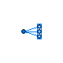
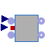
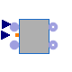

## [OpenTEMPEST.SOC.Stack](OpenTEMPEST_SOC_Stack.md#opentempestsocstack).Components

### Package Content

| Name                                                                                                                                                                                                                  | Description |
| -----------------------------------------------------------------------------------------------------------------------------------------------------------------------------------------------------------------------| -------------|
|  [DummyManifold](OpenTEMPEST_SOC_Stack_Components.md#opentempestsocstackcomponentsdummymanifold)                |             |
|  [FlowInterpolator](OpenTEMPEST_SOC_Stack_Components.md#opentempestsocstackcomponentsflowinterpolator)       |             |
|  [FlowInterpolator1D](OpenTEMPEST_SOC_Stack_Components.md#opentempestsocstackcomponentsflowinterpolator1d) |             |

##  [OpenTEMPEST.SOC.Stack.Components](OpenTEMPEST_SOC_Stack_Components.md#opentempestsocstackcomponents).DummyManifold

### Parameters

| Name                       | Description                                                                       |
| ----------------------------| -----------------------------------------------------------------------------------|
| replaceable package Medium |                                                                                   |
| nPorts_b                   | Total number of outlet ports (mass is distributed evenly between the outlet ports |
| nDummyPorts_b              | Number of dummy outlet ports                                                      |

### Connectors

| Name                                | Description |
|-------------------------------------|-------------|
| replaceable package Medium          |             |
| port_a                              |             |
| ports_b\[nPorts_b - nDummyPorts_b\] |             |

##  [OpenTEMPEST.SOC.Stack.Components](OpenTEMPEST_SOC_Stack_Components.md#opentempestsocstackcomponents).FlowInterpolator

### Parameters

| Name | Description |
|----|----|
| nCell | total number of single cells |
| nSimplified | number of simplified cells among nCell |
| nNonUnitOrSimpCells | Number of Top and Bottom Cell models |
| isRedu\[nCell - nNonUnitOrSimpCells\] |   |
| TStart | \[K\] |
| pStart | \[Pa\] |
| XFuelStart\[Fuel.nX\] | \[1\] |
| posDetailed | Position of the detailed cell |
| replaceable package Fuel |   |
| replaceable package Air |   |
| Initialization |  |
| pStartAir | Starting Pressure on the air side \[Pa\] |
| pStartFuel | Starting Pressure on the fuel side \[Pa\] |

### Connectors

| Name                     | Description |
|--------------------------|-------------|
| replaceable package Fuel |             |
| replaceable package Air  |             |
| fuelExit                 |             |
| airExit                  |             |
| fuelInlet                |             |
| airInlet                 |             |
| hT\[nCell\]              |             |
| TOutAirSimp              |             |
| TOutFuelSimp             |             |

##  [OpenTEMPEST.SOC.Stack.Components](OpenTEMPEST_SOC_Stack_Components.md#opentempestsocstackcomponents).FlowInterpolator1D

### Parameters

| Name | Description |
|----|----|
| nCell | total number of single cells |
| N | Number of control volumes |
| nSimplified | number of simplified cells among nCell |
| nNonUnitOrSimpCells | Number of Top and Bottom Cell models |
| isRedu\[nCell - nNonUnitOrSimpCells\] |   |
| TStart | \[K\] |
| pStart | \[Pa\] |
| XFuelStart\[Fuel.nX\] | \[1\] |
| posDetailed | Position of the detailed cell |
| replaceable package Fuel |   |
| replaceable package Air |   |
| Initialization |  |
| pStartAir | Starting Pressure on the air side \[Pa\] |
| pStartFuel | Starting Pressure on the fuel side \[Pa\] |

### Connectors

| Name                     | Description |
|--------------------------|-------------|
| replaceable package Fuel |             |
| replaceable package Air  |             |
| fuelExit                 |             |
| airExit                  |             |
| fuelInlet                |             |
| airInlet                 |             |
| dHT\[nCell\]             |             |
| TOutAirSimp              |             |
| TOutFuelSimp             |             |

[Automatically generated](http://www.3ds.com/) Sun Sep 20 19:09:48 2026.
